# Gastos Familiares — Plan final

> App hogareña, gratis y mobile-first: el **balance general de la casa** de la familia.
> Ingresos, gastos y cuotas en una planilla de Google **nuestra**, y una app para cargar en segundos y ver cuánto nos queda.
>
> Versión 4 · 2026-10-12 · Los diagramas son Mermaid (se ven en GitHub y en VS Code con soporte Mermaid).

---

## 0. Resumen en 30 segundos

- **Qué es:** una PWA (web app instalable) en **TypeScript + React**, publicada en **Cloudflare** (antes Netlify). Funciona en el **Android de Nico** y el **iPhone de Mica**, y está **abierta a otras familias**, gratis.
- **Qué hace:** registra **gastos** (incluidas **compras en cuotas**) e **ingresos**, y muestra **cuánto nos queda en el mes**, en qué se va la plata y quién gasta en qué.
- **Dónde están los datos:** en una **Google Sheets** del Drive de Nico, compartida con la familia.
- **Familia:** Nico es el **dueño** y desde la app **invita integrantes con su Gmail** (Mica hoy, los chicos el día de mañana). Gratis.
- **Login:** cada integrante con su **cuenta de Google**, **una sola vez**.
- **Velocidad:** el gasto se guarda **al instante en el teléfono** y se sube a la planilla en segundo plano. Funciona sin señal.
- **Objetivo:** de desbloquear el teléfono a gasto guardado en **menos de 5 segundos**.
- **Costo:** $0, también con muchas familias: cada una guarda sus datos en su propio Drive. El plan de escala está en [`docs/ESCALA.md`](docs/ESCALA.md).

---

## 1. Decisiones tomadas

### 1.1 Definidas por ustedes

| Tema | Decisión |
|---|---|
| Teléfonos | **Android (Nico) + iPhone (Mica)**. La prueba de la Etapa 1 se hace en los dos |
| Medios de pago | Efectivo, Débito, Crédito, Transferencia, Mercado Pago |
| Cuotas | **Sí, desde la v1** |
| Ingresos | **Sí, desde la v1**. La app es el **balance general de la casa** |
| Integrantes | Nico es el **dueño**: agrega y quita integrantes **desde la app**, con su cuenta de Google (Mica hoy, los hijos más adelante). Detalle en la sección 5 |
| Resumen | **Todo es de la casa.** El detalle por persona es solo para saber quién gasta en qué y moderarnos. **No hay "quién le debe a quién"** |
| Nombre | **Gastos Familiares** |
| Categorías | A propuesta mía (sección 11) |
| Demo | Una **demo con datos de ejemplo** para mostrarle la app a Mica antes de conectarla a Google (sección 17) |
| Primera cuota (2026-10-16) | Por defecto, **el mes siguiente a la compra** (cuando suele llegar en el resumen). Al cargar se elige otro mes: el de la compra o hasta 3 meses después. Antes era el mes de la compra y una compra en 3 cuotas les quedó mal |
| Pantallas (2026-10-16) | **El teléfono es la prioridad**, pero tablet y compu tienen que andar bien (menú lateral en la compu, dos columnas, hojas como ventana, teclado físico). Cada cambio se prueba en los tres tamaños |
| Íconos (2026-10-16) | **De línea y sobrios, sin emojis** en la app: tiene que verse profesional y seria, no infantil. Son de Lucide (gratis, licencia ISC). Los emojis quedan solo en la pestaña Categorias de la planilla |
| Planilla a mano (2026-10-17) | No se le puede sacar el acceso a nadie (la app escribe con la cuenta de cada uno), así que se la **protege**: aviso al editar en todas las pestañas, una pestaña `Léeme` primera y el botón "Abrir la planilla" **solo para el dueño**. Si algo se rompe, se vuelve atrás con el historial de versiones de Google |
| Avisos (2026-10-17) | **Sin servidor:** el calendario del teléfono avisa con la app cerrada (botón "Agregalo a tu calendario" en cada tarjeta y fijo: Google Calendar o un .ics) y, al abrir la app, una vez por día, un aviso con lo que vence y lo que falta pagar. Se descartó mandar notificaciones desde Cloudflare: el servidor tendría que guardar fechas de cada familia |
| Lo que faltaba de la Etapa 10 (2026-10-17) | **Ahorro y dólares:** solo cuánto hay, en pesos y en dólares, sin pasarlo a pesos con una cotización; comprar dólares es ahorro, no gasto. **Inflación:** traída del INDEC por internet (opcional). **Mesada:** alcanza con un gasto fijo. **Rol "solo carga":** cada chico carga en una planilla chiquita solo suya, y la app del dueño trae lo cargado; los chicos no ven el resto. Lo que gastan **no suma al balance** de la familia (la mesada ya es un gasto fijo: sería contarlo dos veces), se ve aparte; el chico ve Cargar, su Lista y su propio Mes; los de ahora tienen 13 o más (cuenta de Google común) |
| Otras familias (2026-10-15) | **Sí, gratis y sin cobrar mantenimiento.** Se esperan menos de 1.000 familias, pero se diseña a gran escala "para no tener sobresaltos" (sección 15 y [`docs/ESCALA.md`](docs/ESCALA.md)) |
| Hosting (2026-10-15) | **Cloudflare** en vez de Netlify: al pasarse del límite gratis falla solo el login hasta el día siguiente (Netlify pausa todo el sitio un mes), publicar no cuesta y el sitio de prueba vuelve a ser gratis. **Sin dominio propio** por ahora (costo cero) |
| Datos en D1 (2026-10-21) | **Los datos pasan de la planilla de Google del dueño a una base D1 en la cuenta de Cloudflare de la app**, por el Google lleno (§16): con el espacio de un dueño agotado, nadie de su familia puede cargar, y una familia nueva no puede ni empezar. Sigue gratis. Las familias que ya la usan se mudan solas, de a poco, sin perder datos y **sin enterarse** (sin avisos: pedido del usuario); la planilla vieja queda como respaldo congelado en el Drive de cada dueño, y al final la app no usa más Drive. Revierte "los datos nunca pasan por el servidor". Se trabaja en la rama `Migracion-db-D1-cloudflare`, por fases, y cada fase terminada se mergea a `dev` (Etapa 11 de §17, `docs/PLAN-D1.md` §8). **En pausa desde el 2026-10-22:** a muchas familias les gusta como está; queda a futuro, o se descarta, en la rama `Migracion-db-D1-cloudflare` |

> 🔒 Los emails **no** se escriben en el repo: los integrantes son las personas con las que está compartida la planilla.

### 1.2 Supuestos míos (se pueden cambiar)

| Supuesto | Valor por defecto | Alternativa |
|---|---|---|
| Quién crea la planilla y el proyecto de Google Cloud | **Nico**, que la comparte con Mica | Mica |
| Período del balance | **Mes calendario** (1 al último día) | De cobro a cobro |
| Cómo se cargan las cuotas | Se carga el **monto total** y la app lo divide | Cargar el valor de la cuota |
| Moneda | Solo **pesos** | Dólares más adelante |
| Datos anteriores | **Arrancamos de cero** | Importar una planilla vieja |
| Edición de categorías | En la **planilla** (v1) | Pantalla de configuración en la app (después) |

---

## 2. Requisitos

| Requisito | Meta concreta |
|---|---|
| Carga ultra rápida | < 5 s y 2–3 toques para un gasto común |
| Funciona sin señal | Cargar, ver y editar offline. Sube cuando hay red |
| Varios integrantes | Todos cargan. Cada uno ve lo de los demás al abrir la app. El dueño suma o quita gente sin tocar código ni el hosting |
| Balance real | Ingresos − gastos del mes, con las cuotas imputadas al mes que corresponden |
| Datos nuestros | Todo en una planilla que podemos abrir y editar a mano |
| Seguro | Solo los integrantes de la familia pueden ver o escribir los datos |
| Costo | $0 por mes |
| Escalable | Cambiar de base de datos sin reescribir la app |

---

## 3. Arquitectura

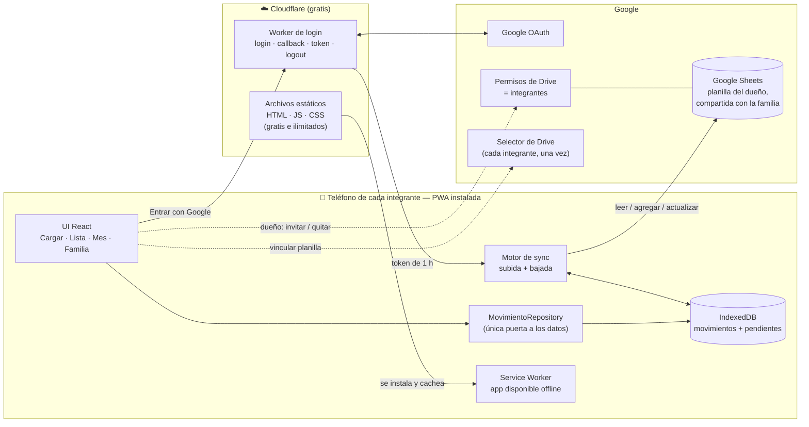

**Ideas clave**

1. **El teléfono es la fuente inmediata y la planilla es la fuente de verdad.** La UI siempre lee de IndexedDB, nunca espera a internet.
2. **El backend es mínimo y no guarda datos.** El Worker de Cloudflare solo maneja la sesión de Google. Los datos van **directo** del teléfono a Google.
3. **Una sola puerta a los datos (`MovimientoRepository`).** Cambiar Sheets por otra base mañana no toca la UI. La demo usa esa misma puerta con datos de ejemplo.
4. **Los integrantes son las personas con las que está compartida la planilla.** No hay otra lista que mantener: Google es la única fuente de verdad de quién tiene acceso.

---

## 4. Login y seguridad

### 4.1 Login (una sola vez por teléfono)

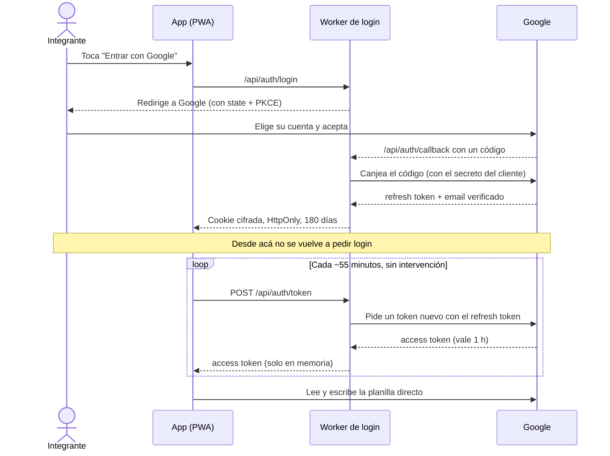

> 📱 **iPhone:** en iPhone hay que loguearse **desde la app instalada** (ícono en la pantalla de inicio), no desde Safari. En iOS, la app instalada y Safari guardan sesiones separadas.

### 4.2 Capas de seguridad

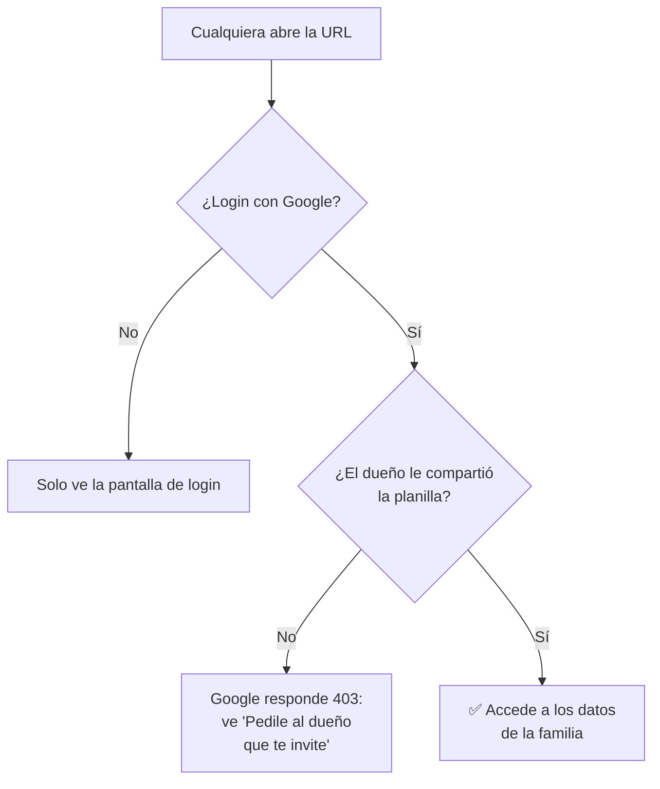

| Medida | Qué protege |
|---|---|
| Planilla compartida solo con los integrantes | **La barrera principal, controlada por Google.** Si el dueño no te invitó, Google no te deja leer ni escribir nada |
| Permiso `drive.file` | El token solo toca la planilla de la app, no el resto del Drive |
| Refresh token cifrado (AES-GCM) en cookie `HttpOnly` + `Secure` + `SameSite=Lax` | El JavaScript de la página nunca ve el token largo |
| Access token solo en memoria (1 h) | Daño acotado a 1 hora y a esa planilla |
| `state` + PKCE en el login; verificación de `Origin` en `/api/auth/token` | Ataques de login cruzado y CSRF |
| Cabeceras CSP en `public/_headers` | Solo se permite hablar con Google, con nuestro propio sitio y (desde 2026-10-17, para "Con inflación") con la API pública del INDEC en datos.gob.ar |
| Sin analytics ni scripts de terceros | Menos superficie de ataque |
| Teléfono perdido → revocar en *myaccount.google.com → Seguridad → Apps de terceros* | Corta el acceso al instante |

**¿Y si alguien ajeno encuentra la URL?** Puede loguearse con su Google, pero **nunca ve nuestros datos**: Google no le deja abrir la planilla. Solo ve un mensaje para pedir que lo inviten.

**Secretos:** el *Client Secret* de Google y la clave de cifrado van **solo** como secretos del Worker en Cloudflare. El *Client ID* es público por diseño.

**Google Cloud:** proyecto gratis en la cuenta de Nico, sin tarjeta. Se habilitan Sheets API, Drive API y Picker API. La pantalla de consentimiento se pone en **"En producción"**, porque en modo "Prueba" Google vence la sesión cada 7 días. Con `drive.file` (permiso no sensible) no hace falta verificar la app.

---

## 5. Familia: dueño e integrantes

### 5.1 Roles

| Rol | Quién | Qué puede hacer |
|---|---|---|
| **Dueño** | Nico (quien crea la planilla) | Todo lo de un integrante, más **invitar y quitar integrantes** |
| **Integrante** | Mica, y los hijos el día de mañana | Cargar, editar y ver todos los movimientos de la familia |

**Cómo funciona por dentro:** los integrantes son las personas con las que está compartida la planilla en Google Drive. Cuando el dueño invita a alguien desde la app, la app comparte la planilla con ese Gmail. Cuando lo quita, le saca el permiso. **No hay otra lista que mantener ni nada que tocar en el hosting.** En la pestaña `Integrantes` de la planilla se guarda solo el apodo y el color de cada uno.

### 5.2 Primera vez: el dueño crea la planilla

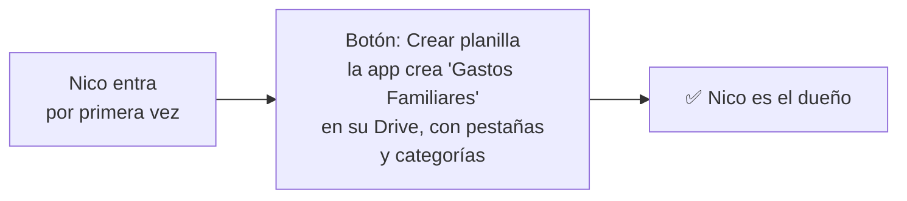

### 5.3 Invitar a un integrante

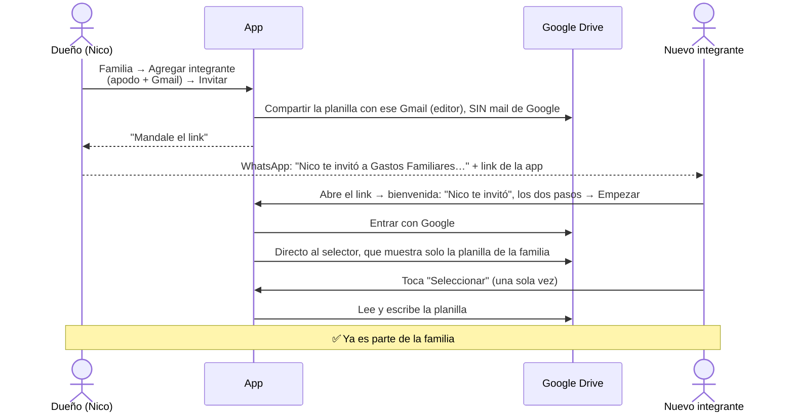

- **Sin el mail de Google** (2026-10-18, pedido del usuario): ese mail hablaba de una hoja de cálculo y la gente no entendía cómo entrar a la app. La planilla se comparte en silencio y la invitación es el **link de la app**, que el dueño manda por WhatsApp desde Familia (al invitar se ofrece enseguida; y cada invitado que todavía no entró tiene su "Mandar el link"). El link lleva quién invita (`&de=Nico`, solo el apodo).
- **El invitado no ve la planilla más que una vez:** la bienvenida le explica los dos pasos antes de empezar; después de entrar con Google, la app lo lleva directo a confirmarla, sin pantallas intermedias. Si algo falla, ahí aparecen los otros caminos (el otro selector, elegirla desde una compu).
- **El paso del selector** existe porque, con el permiso `drive.file`, Google exige que cada persona elija la planilla una vez. Es un solo toque, porque la app le pide a Google que muestre solo esa (`file_ids`; que Google lo respete con nuestro tipo de cliente está por confirmar: PENDIENTES #18).
- **Teléfono nuevo de la misma persona:** la app encuentra la planilla sola, sin repetir el paso.
- **Otras opciones, descartadas por ahora:** pedir el permiso `spreadsheets` evitaría el selector, pero Google lo muestra como "ver, editar y borrar todas tus hojas de cálculo" y exige verificar la app; guardar los datos en una base propia (por ejemplo, D1 de Cloudflare) evitaría Google para los invitados, pero los datos de las familias pasarían por nuestro servidor (§1.1).

### 5.4 Quitar a un integrante

El dueño toca **Quitar** en la pantalla Familia y la app le saca el permiso de la planilla. **Desde ese momento Google le niega el acceso.** En su teléfono, la app muestra "Ya no tenés acceso" y borra la copia local. Sus movimientos viejos **quedan** en la planilla, porque son historia de la casa.

**Salir o borrar la familia** (2026-10-18, pedido del usuario: una cuenta que ya estaba en una familia no podía sumarse a otra). Cada cuenta está en una sola familia; para liberarla:

- Un **integrante** toca **Salir de la familia** (Tu cuenta o Familia). La app le saca su acceso a la planilla. Si Google no lo deja, lo anota en su fila de Integrantes (`salio`) y la app del dueño le saca el acceso en su próxima pasada.
- El **dueño** toca **Borrar la familia**. La app les saca el acceso a todos y manda la planilla (y las de los chicos) a la papelera de su Drive, donde quedan 30 días.
- En los dos casos, una hoja explica qué pasa antes de hacerlo, y la app vuelve al inicio sin volver a abrir sola esa familia en ese teléfono.
- Si alguien que ya está en una familia abre el link de **otra**, la app se lo avisa y le ofrece salir de la suya y sumarse.

### 5.5 ¿Y los chicos?

- **Con 13 años o más** tienen una cuenta de Google común: se los invita igual que a Mica.
- **Con menos de 13**, Google les da una cuenta supervisada con **Family Link**. Es probable que ustedes tengan que **aprobar desde Family Link** que usen la app. Lo probamos cuando llegue el momento.
- **Todos los integrantes ven todo.** La planilla es una sola y compartida, así que no se puede ocultar a un integrante lo que cargan los demás.
- **Un hijo que solo carga** (Etapa 10, 2026-10-17): no se lo invita como integrante, sino desde "Chicos que solo cargan" en Familia. La app le crea una planilla chiquita solo suya y se la comparte: carga ahí y no ve nada de la familia. La app del dueño trae lo que carga a la planilla de la familia, donde se ve aparte (no suma al balance: la mesada ya es un gasto fijo).

### 5.6 La versión de prueba no toca los datos reales

La app publicada en la rama `dev` (y en la compu) usa una **planilla de prueba aparte** (`Gastos Familiares (prueba)`). Se distingue sola por la dirección web, así que probar cosas nunca ensucia la planilla de la familia.

---

## 6. Modelo de datos

### 6.1 Planilla `Gastos Familiares`

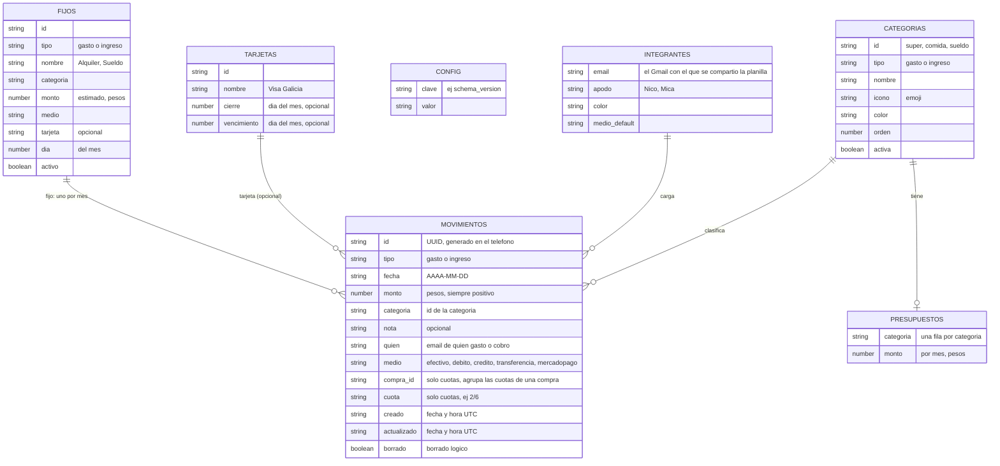

Desde la Etapa 9, `Movimientos` suma las columnas `tarjeta` y `fijo` (y desde la 10, `etiqueta`), y hay tres pestañas nuevas (`Tarjetas`, `Fijos`, `Presupuestos`, con `id`, `actualizado` y `borrado` como las demás; en la 10 se suman `Metas`, `Ahorros`, y para el rol "solo carga" `Chicos` (`planilla, email, apodo, color, actualizado, borrado`) y `De los chicos`, con las columnas de Movimientos). La planilla de cada chico tiene solo `Léeme`, `Movimientos` y `Config` (con `tipo = chico`). En una planilla vieja, la app las agrega sola la primera vez que la abre.

**Reglas de la planilla**

- **Una sola pestaña `Movimientos`** para gastos e ingresos (columna `tipo`). El monto siempre es positivo y el tipo define si suma o resta.
- **Las filas nunca se borran físicamente.** Borrar marca `borrado = TRUE`. Así las posiciones no se corren y varios pueden editar sin pisarse.
- **`Integrantes` es solo para mostrar** (apodo y color). Quién tiene acceso lo deciden los permisos de Drive de la planilla (sección 5).
- **La app lee los encabezados por nombre, no por posición.** Agregar una columna a mano no rompe nada.
- **Se escribe en modo RAW**, sin inyección de fórmulas y sin que Sheets "adivine" fechas.
- **Todas las pestañas** se protegen con **"mostrar advertencia"** (2026-10-17; antes solo `Movimientos`): se pueden editar a mano, pero Google avisa antes. La primera pestaña es **`Léeme`**: dice que es la base de datos de la app, que se cambia desde la app y cómo restaurar una versión de antes desde el historial. Una planilla vieja recibe las dos cosas sola, una vez. Para mirar ordenado está la pestaña `Vista`, con `=SORT(FILTER(...))`.
- **Plata:** dentro de la app se calcula en **centavos enteros**. Se muestra con formato `es-AR` ($ 2.500,00).

---

## 7. Cuotas

**Cómo se cargan:** monto total + medio (Crédito o Mercado Pago) + cantidad de cuotas. La app genera **una fila por cuota**, cada una en su mes.

**Ejemplo:** heladera de $ 600.000 en 6 cuotas, comprada el 12/10/2026, eligiendo que la primera cuota caiga en octubre (por defecto caería en noviembre).

| fecha | monto | cuota | compra_id |
|---|---|---|---|
| 2026-10-12 | 100.000 | 1/6 | `a1b2…` |
| 2026-11-12 | 100.000 | 2/6 | `a1b2…` |
| 2026-12-12 | 100.000 | 3/6 | `a1b2…` |
| 2027-01-12 | 100.000 | 4/6 | `a1b2…` |
| 2027-02-12 | 100.000 | 5/6 | `a1b2…` |
| 2027-03-12 | 100.000 | 6/6 | `a1b2…` |

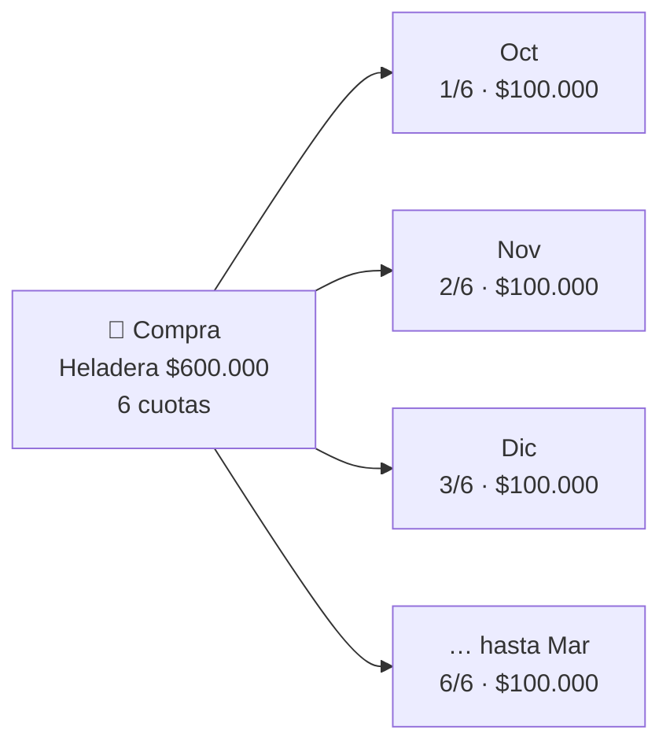

**Por qué una fila por cuota** (y no una fila con "6 cuotas"):
- El balance de cada mes queda **bien solo**: se suman los movimientos con fecha de ese mes.
- En la planilla se lee claro qué se paga cada mes.
- Cada cuota es un movimiento común para la sync: no hay casos especiales.

**Reglas**
- **Primera cuota:** por defecto el **mes siguiente** a la compra. Al cargar se elige el mes: el de la compra o hasta 3 meses después (promos de "primera cuota a 90 días"). Cada cuota cae el mismo día que la compra.
- **Redondeo:** se divide en centavos y la última cuota absorbe la diferencia (por ejemplo $100.000 en 3 cuotas = 33.333,33 + 33.333,33 + 33.333,34).
- **Fin de mes:** si la compra es el día 31, en los meses más cortos la cuota cae el último día (30, o 28/29 en febrero).
- **Cuotas con interés:** se carga el **total financiado** (lo que realmente se paga).
- **Editar o borrar** una cuota actúa sobre **toda la compra**, con la opción "solo las cuotas que faltan" (por ejemplo si se adelantan).
- Las cuotas futuras alimentan el indicador **"Comprometido próximos meses"** (sección 8).

---

## 8. Ingresos y balance

```
  Te queda este mes  =  Ingresos del mes  −  Gastos del mes (incluye las cuotas que caen este mes)
```

- **Categorías de ingreso propias:** Sueldo, Aguinaldo, Extras, Reintegros, Otros ingresos.
- **Comprometido próximos meses:** la suma de cuotas futuras ya cargadas, mes por mes. Responde "¿cuánto del sueldo de noviembre ya está gastado?".
- **Quién gasta en qué:** cada categoría se muestra partida entre los integrantes, con colores neutros y **sin rankings**. Es información para moderarnos, no una competencia.

---

## 9. Sincronización

### 9.1 Ciclo de vida de un movimiento

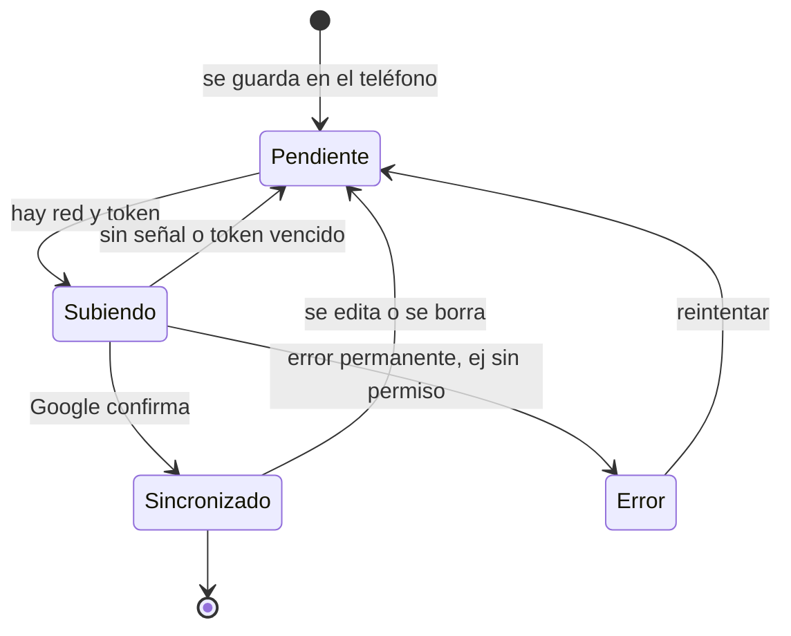

En la lista, un movimiento `Pendiente` muestra un relojito. Nada se pierde mientras esté en el teléfono.

### 9.2 Subida y bajada

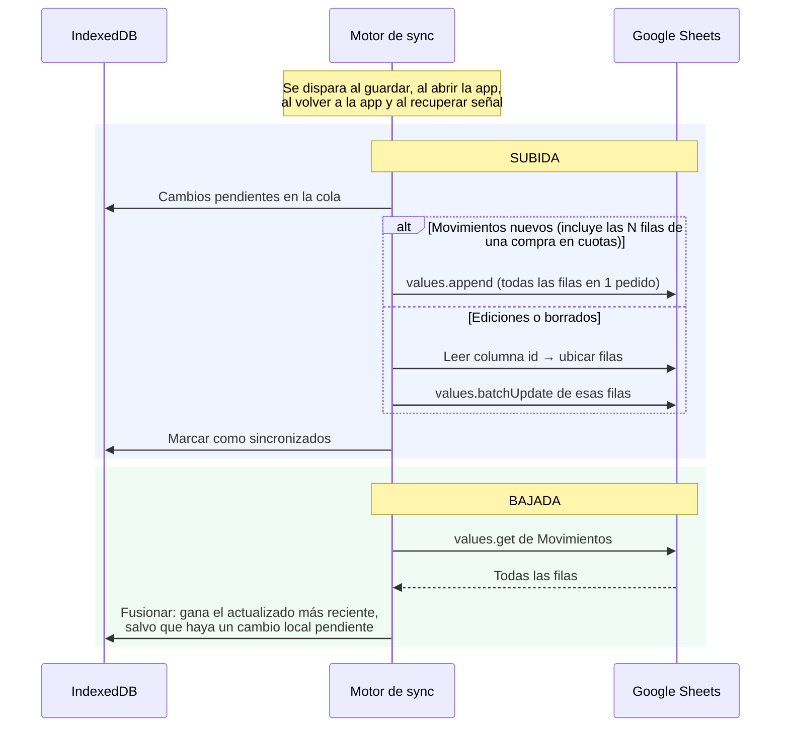

| Problema | Solución |
|---|---|
| Varios cargan al mismo tiempo | `append` agrega al final sin pisar filas |
| Dos editan el mismo movimiento | Gana el último cambio (`actualizado`). En una familia es un caso rarísimo |
| Se cortó la red al subir: ¿se guardó o no? | **Reintento idempotente:** antes de re-agregar, se busca el `id` en la planilla |
| Alguien ordena o borra filas a mano | La app nunca confía en el número de fila: siempre busca por `id` |
| iPhone no tiene sync en segundo plano | Sync al abrir la app o volver a ella y al recuperar señal (alcanza de sobra) |
| Muchas familias comparten la cuota de lecturas de Sheets (300 por minuto) | Se lee en un solo pedido y solo si la planilla cambió (versión de Drive); después de subir no se relee. Detalle en [`docs/ESCALA.md`](docs/ESCALA.md) |
| Google se satura y responde 429/5xx | Las pasadas automáticas esperan cada vez más (2 a 30 minutos, con azar). Lo cargado queda en el teléfono |
| iOS puede borrar datos locales de sitios web | Con la app instalada no aplica el límite de 7 días. Además se pide `navigator.storage.persist()` y se sube enseguida |

---

## 10. Pantallas

### 10.1 El flujo del helado 🍦

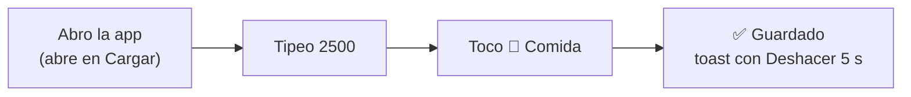

**Tres acciones.** Tipo = gasto, fecha = hoy, quién = la cuenta logueada y medio = el último usado vienen precargados. Todo se cambia con un toque si hace falta.

### 10.2 Cargar (pantalla principal)

```
┌────────────────────────────────┐
│ [Gasto]  Ingreso        Hoy ▾  │  ← tipo y fecha
│ Te quedan $ 515.700 este mes   │  ← para moderarnos
│                                │
│             $ 2.500            │
│  + nota     Nico ▾   Efectivo ▾│
│                                │
│  [ Super ] [ Comida ] [Transp] │  ← TOCAR = GUARDAR
│  [ Casa  ] [Servic. ] [ Más  ] │    ordenadas por uso
│                                │
│     1        2        3        │
│     4        5        6        │  ← teclado propio, grande
│     7        8        9        │
│    000       0        ⌫        │
│   [Cargar]   [Lista]   [Mes]   │
└────────────────────────────────┘
```

### 10.3 Cargar en cuotas

Al elegir **Crédito** o **Mercado Pago** aparece la fila de cuotas:

```
┌────────────────────────────────┐
│ [Gasto]  Ingreso        Hoy ▾  │
│            $ 600.000           │
│  + nota     Nico ▾    Crédito ▾│
│  Cuotas [1] [3] [6] [12] [··]  │
│         6 × $ 100.000          │
│  1ª: nov ▾  (elige el mes)     │
│                                │
│  [ Casa  ] [ Super ] [ Más  ]  │  ← tocar = guarda las 6
│   …teclado…                    │
└────────────────────────────────┘
```

### 10.4 Lista

```
┌────────────────────────────────┐
│  Octubre ▾       Todo ▾  Nico ▾│  ← filtros
│  Hoy                           │
│   Helado     Comida   − $ 2.500│
│   Heladera 1/6 Casa −$ 100.000 │
│  Ayer                          │
│   SUBE ⏳    Transp   − $ 5.000│  ← ⏳ pendiente de subir
│  1 oct                         │
│   Sueldo     Ingreso +$ 900.000│
│  tocar = editar · deslizar = borrar │
│   [Cargar]   [Lista]   [Mes]   │
└────────────────────────────────┘
```

### 10.5 Mes (balance)

```
┌────────────────────────────────┐
│  ◀     Octubre 2026     ▶      │
│  Ingresos        $ 1.500.000   │
│  Gastos          $   984.300   │
│  ──────────────────────────    │
│  Te quedan       $   515.700   │
│  ████████████████░░░░  66% gastado │
│                                │
│  Por categoría  ■ Nico ■ Mica …│
│  Super    █████▓▓▓▓▓  $310.000 │
│  Casa     ████▓▓▓▓▓▓  $250.000 │  ← cada barra partida
│  Comida   ███▓▓       $120.000 │    por persona
│  …                             │
│                                │
│  Comprometido en cuotas        │
│  Nov $ 145.000 · Dic $ 100.000 │
│  vs. septiembre: gastos +8%    │
│   [Cargar]   [Lista]   [Mes]   │
└────────────────────────────────┘
```

### 10.6 Familia

```
┌────────────────────────────────┐
│  Familia                       │
│                                │
│  ● Nico    nico@…     Dueño    │
│  ● Mica    mica@…     Integrante  [Quitar] │
│                                │
│  ＋ Agregar integrante         │  ← solo lo ve el dueño
│     Apodo  [ Juan          ]   │
│     Gmail  [ juan@gmail.com ]  │
│     [ Invitar ]                │
│                                │
│  Le llega un mail de Google    │
│  con el link de la app.        │
│ [Cargar] [Lista] [Mes] [Familia] │
└────────────────────────────────┘
```

Detalles que suman velocidad:
- **Teclado numérico propio:** no aparece el teclado del sistema y los botones son enormes.
- **Categorías ordenadas por frecuencia de uso.**
- **Atajo "Nuevo gasto"** al mantener apretado el ícono (Android) y vibración corta al guardar.
- **"Deshacer" en vez de "¿Está seguro?"**: ningún diálogo de confirmación.

---

## 11. Categorías y medios iniciales

Se crean junto con la planilla y se pueden editar ahí (cambiar nombre, ícono, orden o desactivar).

**Gastos**

| id | Nombre | Ícono | Ejemplos |
|---|---|---|---|
| `super` | Super | 🛒 | Supermercado, almacén, verdulería, carnicería |
| `comida` | Comida y salidas | 🍔 | Delivery, restaurantes, café, helado |
| `casa` | Casa | 🏠 | Alquiler, expensas, arreglos, muebles, electrodomésticos |
| `servicios` | Servicios | 💡 | Luz, gas, agua, internet, celular |
| `transporte` | Transporte | 🚌 | SUBE, nafta, peajes, estacionamiento, Uber |
| `salud` | Salud | 💊 | Prepaga, farmacia, consultas |
| `ropa` | Ropa | 👕 | Ropa, calzado |
| `suscripciones` | Suscripciones | 📺 | Streaming, música, apps |
| `ocio` | Ocio | 🎉 | Cine, salidas, viajes, hobbies |
| `regalos` | Regalos | 🎁 | Cumpleaños, fiestas |
| `cuidado` | Cuidado personal | 💈 | Peluquería, cosmética, gimnasio |
| `otros` | Otros | 📦 | Lo que no entra en ninguna |

**Ingresos**

| id | Nombre | Ícono |
|---|---|---|
| `sueldo` | Sueldo | 💼 |
| `aguinaldo` | Aguinaldo | 🎄 |
| `extras` | Extras | ✨ |
| `reintegros` | Reintegros | ↩️ |
| `otros_ingresos` | Otros ingresos | 💰 |

**Medios de pago:** Efectivo 💵 · Débito 💳 · Crédito 💳 *(permite cuotas)* · Transferencia 🏦 · Mercado Pago 📲 *(permite cuotas)*.

---

## 12. Stack

| Capa | Elección | Por qué |
|---|---|---|
| Lenguaje | **TypeScript** (modo estricto) | Un solo lenguaje para la app y las funciones |
| UI | **React 19 + Vite** | Ecosistema enorme y build rápido |
| Estilos | **Tailwind CSS** | Mobile-first rápido de escribir |
| PWA | **vite-plugin-pwa** (Workbox) | Instalable, offline y aviso de "nueva versión" |
| Datos locales | **IndexedDB** vía idb-keyval | Pesa < 1 KB. La copia local entra entera en memoria (es chica), así que no hacen falta consultas: se eligió en vez de Dexie |
| Validación | Validación propia (`data/validar.ts`) | La planilla la pueden tocar humanos, así que se valida lo que viene. Alcanzó sin Zod y sin sumar peso |
| Datos remotos | Google Sheets API v4 (`fetch` directo) | Sin SDK pesado de Google |
| Auth | Worker de Cloudflare (`Request`/`Response` estándar, sin `Buffer`) | Mínimo y portable: es la misma lógica que corría en Netlify |
| Gráficos | SVG propio **con carga diferida** | Barras simples, no pesa en la pantalla Cargar |
| Tests | **Vitest** | Dominio (cuotas, balance, plata) y sync (fusión) |

**Meta de rendimiento:** menos de ~150 KB comprimidos para abrir Cargar. Como el service worker la tiene cacheada, abre al instante incluso sin señal.

---

## 13. Estructura del proyecto

```
gastos-familiares/
├─ servidor/                 # login (Worker de Cloudflare), sin dependencias de plataforma
│  ├─ worker.ts              # entrada: rutea /api/auth/{login,callback,token,logout}
│  ├─ auth.ts                # la lógica de los 4 endpoints, con tests
│  └─ google.ts, cifrado.ts, cookies.ts, config.ts
├─ public/                   # íconos, privacidad y _headers (cabeceras de seguridad)
├─ src/
│  ├─ app/                   # layout, navegación inferior, rutas
│  ├─ features/
│  │  ├─ cargar/             # pantalla principal, cuotas, ingreso
│  │  ├─ lista/              # historial, filtros, editar/borrar
│  │  ├─ mes/                # balance y gráficos (carga diferida)
│  │  ├─ familia/            # integrantes: invitar y quitar
│  │  └─ setup/              # crear / vincular planilla
│  ├─ data/
│  │  ├─ repository.ts       # MovimientoRepository: lo único que ve la UI
│  │  ├─ demo/               # repositorio con datos de ejemplo (la demo)
│  │  ├─ google/             # Drive, Sheets, copia local (IndexedDB) y repositorio real
│  │  ├─ sheets/             # cliente HTTP + mapeo filas ⇄ objetos
│  │  └─ sync/               # cola, subida, bajada, fusión
│  ├─ auth/                  # sesión, renovación de token, selector de Drive
│  ├─ domain/                # Movimiento, cuotas, balance, dinero, fechas
│  └─ ui/                    # teclado, toast, chips, barras…
├─ tests/
├─ wrangler.jsonc            # Cloudflare: Worker, archivos estáticos, sitio de prueba
├─ vite.config.ts
└─ PROPUESTA.md
```

---

## 14. Hosting: Cloudflare y ramas

Hasta el 2026-10-15 la app estuvo en Netlify (plan gratis por créditos: 300 por mes, 15 por cada deploy a producción). Se mudó a Cloudflare al abrirla a otras familias. Según la [documentación de Cloudflare](https://developers.cloudflare.com/workers/platform/pricing/), consultada el 2026-10-15:

| Concepto (plan gratis) | Límite | Nuestro uso |
|---|---|---|
| Archivos estáticos (la app) | **Gratis e ilimitados** | Todo lo que no es `/api/*` |
| Pedidos al Worker (login) | **100.000 por día**; al pasarse falla solo `/api/*` hasta medianoche UTC | ~6 por familia por día → alcanza para ~16.000 familias |
| Procesador por pedido | 10 ms | El login usa poco: cifrar, descifrar y esperar a Google (hipótesis, PENDIENTES #14) |
| Publicar | Sin costo por publicación ([Workers Builds](https://developers.cloudflare.com/workers/ci-cd/builds/limits-and-pricing/): 3.000 minutos de build por mes) | Un build tarda ~1 minuto |

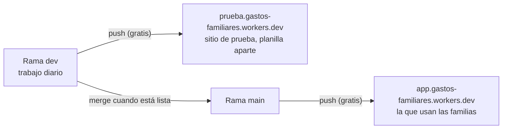

- **Vuelve el sitio de prueba** (decisión del 2026-10-15): en Cloudflare publicar no cuesta, y con muchas familias un cambio roto no puede llegarles a todas. Usa una planilla aparte.
- **Sin dominio propio** por ahora: la dirección es la gratis de Cloudflare. Si algún día se compra uno, cambia la dirección una vez (todos reinstalan), sin perder datos.
- **Escalón pago, solo si hace falta:** Workers Paid, USD 5 por mes con 10 millones de pedidos ([precios](https://developers.cloudflare.com/workers/platform/pricing/)).

---

## 15. Escala y límites

**Una familia:**

| Dato | Cuenta | Conclusión |
|---|---|---|
| Movimientos por año | ~6 por día entre todos + cuotas + ingresos ≈ **5.000 filas** | — |
| Celdas por año | 5.000 × 13 columnas ≈ 65.000 | Sheets admite 10 millones → **más de 100 años** |
| Bajar la planilla completa | Unos cientos de KB (comprimido, bastante menos) | Aceptable incluso con datos móviles, y ahora solo se baja si cambió |
| Cuota de Sheets por persona | 60 lecturas por minuto por persona | Una sesión usa ~1 |

**Muchas familias:** los datos no cuestan nada (cada familia usa su Drive). Lo compartido es el login (Cloudflare) y la **cuota de lecturas de Sheets del proyecto: 300 por minuto entre todas las familias**, que es el techo duro. Capacidad estimada, umbrales y qué hacer en cada caso: [`docs/ESCALA.md`](docs/ESCALA.md).

**Cuando crezca una familia:** un botón **"Archivar año"** mueve los años viejos a otra pestaña, y la app baja solo el año actual y las cuotas futuras.
**Si algún día Sheets no alcanza:** se reemplaza `data/` por Firebase o Supabase. La UI y el dominio no cambian (pero los datos pasarían a estar a nuestro cargo).

---

## 16. Riesgos y mitigaciones

| Riesgo | Probabilidad | Mitigación |
|---|---|---|
| El login de Google falla o no persiste en la **app instalada del iPhone** | **Media**, es el riesgo n° 1 | **Etapa 1 dedicada:** probarlo en el iPhone de Mica antes de construir nada más. Plan B: login en ventana emergente. Plan C: usarla desde Safari sin instalar |
| Muchas familias agotan la cuota de lecturas de Sheets | Baja (hace falta varios miles) | Lecturas mínimas, espera creciente ante errores, umbral con aviso y pedido de más cuota (docs/ESCALA.md). Nada se pierde: queda en el teléfono |
| Se pasa el límite diario del login en Cloudflare | Muy baja | Falla solo el login hasta medianoche UTC; la app sigue abriendo y guardando. Escalón: USD 5/mes |
| En el iPhone el selector de Drive no anda (cookies de Google bloqueadas) | **Alta** (visto el 2026-10-12) | "Permitir cookies" y, si no, elegirla una vez desde una compu; la app la encuentra sola al volver |
| Alguien ordena o borra filas a mano | Media | Protección con advertencia en todas las pestañas, pestaña `Léeme` con cómo volver atrás (historial de versiones de Google), el botón para abrirla solo para el dueño, y búsqueda siempre por `id` |
| Google invalida la sesión (cambio de contraseña, 6 meses sin uso) | Baja | La app lo detecta y pide login. La cola local queda intacta |
| Relojes de los teléfonos desfasados | Baja | "Gana el último cambio" tolera segundos de diferencia |
| Bug en cuotas o sync que duplique o pierda datos | Media | Tests del dominio y de la fusión, `id` único y el historial de versiones de la planilla |
| Compartir la planilla desde la app con el permiso `drive.file` no funciona como se espera | Baja | Se valida en la Etapa 2. Plan B: el dueño comparte desde Google Drive a mano y la app sigue igual |
| La cuenta supervisada (Family Link) de un hijo menor de 13 no puede usar la app | Media | Aprobarla desde Family Link. Se prueba cuando llegue el momento |
| El Google del dueño se llena (Gmail, Fotos y Drive comparten el espacio): nadie de la familia puede guardar, y con el Google lleno no se puede crear la planilla | Media (le pasó a una usuaria el 2026-10-21) | La app lo detecta preguntándole a Drive y no lo confunde con "sin acceso". Lo cargado queda en el teléfono y se sube solo al liberar espacio. Cada uno ve su aviso, con "Ver mi espacio en Google" (docs/GOTCHAS.md, PENDIENTES #29) |

---

## 17. Plan de implementación

**Leyenda:** 👤 = lo hacen ustedes (cuentas y claves; yo los guío paso a paso) · 🤖 = lo hago yo

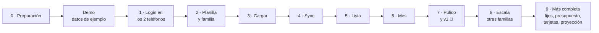

### Etapa 0 · Preparación
- [x] 👤 Cuenta de Netlify (gratis) conectada al repo de GitHub; producción desde `main`. (Reemplazada por Cloudflare en la Etapa 8.)
- [x] 👤 Proyecto de Google Cloud en la cuenta de Nico: habilitar APIs, pantalla de consentimiento "En producción", cliente OAuth web y API key restringida para el selector de Drive.
- [x] 👤 Cargar las variables de entorno en Netlify (`GOOGLE_CLIENT_ID`, `GOOGLE_CLIENT_SECRET`, `SESSION_KEY`, etc.).
- [x] 🤖 Esqueleto: Vite + React + TS + Tailwind + PWA, `netlify.toml`, ramas `main`/`dev`, Vitest, oxlint + Prettier.
- [x] 🤖 Configuración centralizada y comentada (`.env.example`, `src/config.ts`, `servidor/config.ts`) y guía paso a paso en `docs/SETUP.md`.
- **Terminado cuando:** la app vacía está en la URL de `dev` y se instala en ambos teléfonos.

### Demo · Datos de ejemplo (para mostrarle la app a Mica)
- [x] 🤖 Dominio con tests: plata en centavos, fechas, cuotas (división, redondeo, fin de mes) y balance del mes.
- [x] 🤖 Repositorio de demo con datos de ejemplo, guardados solo en el teléfono, detrás de la misma puerta que después usa Google.
- [x] 🤖 Pantallas Cargar, Lista, Mes y Familia funcionando con esos datos.
- [x] 🤖 Búsqueda de bugs en pasadas sucesivas hasta no encontrar más (7 pasadas, 74 tests, verificado en Edge con la CSP real). Detalle en `docs/casos-de-uso-ui.md`.
- [x] 👤 Publicarla y que Mica la pruebe en el iPhone (aprobada el 2026-10-12).
- **Terminado cuando:** Mica la usa, opina y ajustamos lo que no le cierre.

### Etapa 1 · Login en los dos teléfonos (prueba de riesgo)
- [x] 🤖 Las 4 funciones de auth + renovación automática del token (con tests y verificadas empaquetadas con esbuild).
- [x] 🤖 En vez de una pantalla de prueba, la entrada real ("Entrar con Google") con los errores explicados.
- [ ] 👤 Probar en el **Android de Nico** y en el **iPhone de Mica**, desde la app instalada.
- **Terminado cuando:** en los dos teléfonos hay login, se escribe una fila, se cierra la app, **al día siguiente sigue logueado** y escribe sin pedir nada.

### Etapa 2 · Planilla y familia
- [x] 🤖 "Crear planilla" con pestañas, encabezados, categorías, medios, integrantes y protección.
- [x] 🤖 Pantalla Familia real: invitar (compartir la planilla + mail de Google con el link) y quitar.
- [x] 🤖 "Vincular planilla" con el selector de Drive preseleccionado y búsqueda automática en teléfonos nuevos.
- [x] 🤖 Planilla de prueba separada para la rama `dev`.
- [ ] 👤 Nico crea la planilla e invita a Mica desde la app. Mica entra con el link del mail.
- **Terminado cuando:** los dos ven la misma planilla desde la app. Una cuenta no invitada no ve nada. Al quitar a alguien, pierde el acceso.

### Etapa 3 · Cargar
- [x] 🤖 Dominio con tests: plata en centavos, cuotas (división, redondeo, fin de mes) y balance (hecho en la Demo).
- [x] 🤖 Pantalla Cargar (ya hecha en la Demo) conectada a los datos reales.
- [x] 🤖 Guardado local en IndexedDB (idb-keyval).
- **Terminado cuando:** en modo avión se carga un gasto en < 5 s y una compra en 6 cuotas genera las 6 cuotas correctas.

### Etapa 4 · Sync
- [x] 🤖 Cola, subida (append en lote, idempotente), bajada y fusión, con tests (y prueba de mutación).
- [x] 🤖 Disparadores: al guardar, al abrir, al volver a la app y al recuperar señal. Indicador ⏳.
- **Terminado cuando:** Nico carga, Mica abre la app y lo ve. Con red cortada a mitad de una subida no hay duplicados.

### Etapa 5 · Lista
- [x] 🤖 Historial agrupado por día, filtros (mes, tipo, persona), editar y borrar (cuotas: toda la compra o solo las que faltan).
- **Terminado cuando:** editar y borrar se reflejan en la planilla y en el otro teléfono.

### Etapa 6 · Mes
- [x] 🤖 Balance (ingresos − gastos = te queda), barra de % gastado, categorías partidas por persona, comprometido en cuotas, comparación con el mes anterior.
- **Terminado cuando:** los totales coinciden con una suma hecha a mano en la planilla.

### Etapa 7 · Pulido y v1
- [x] 🤖 Nombre e ícono, cabeceras de seguridad y modo oscuro.
- [x] 🤖 Aviso de "hay una versión nueva" (2026-10-17, pedido del usuario: tuvo que borrar la caché para ver cambios). La app pregunta por versiones nuevas al abrir, al volver al frente y cada 30 minutos; se pasa sola si está en segundo plano o no se tocó nada, y si se está usando avisa con "Actualizar" (`app/actualizar.ts`, probado en `npm run e2e`).
- [x] 🤖 Instalar la app desde la app (2026-10-17, pedido del usuario): botón "Instalar" en Android (el aviso del navegador) y los pasos de Compartir → "Agregar a inicio" en el iPhone, en el encabezado, en Tu cuenta y en la entrada.
- [ ] 🤖 Revisión de accesibilidad.
- [x] 🤖 Revisión de seguridad del login y el acceso (sumó `writersCanShare: false`).
- [x] 🤖 Merge a `main` → producción (2026-10-12, en Netlify).
- [ ] 👤 Instalar la versión de producción en los dos teléfonos y empezar a usarla.
- **Terminado cuando:** la usamos una semana sin problemas. 🎉

### Etapa 8 · Escala: abierta a otras familias, gratis (2026-10-15)
- [x] 🤖 Servidor de login sin dependencias de plataforma (`servidor/`) y Worker de Cloudflare, con las cabeceras en `public/_headers`.
- [x] 🤖 Sitio de prueba en Cloudflare (rama `dev`) con su planilla aparte.
- [x] 🤖 Sincronización con pocas lecturas: un pedido por pasada, versión de Drive antes de leer, sin releer después de subir (una sesión típica pasa de ~7 lecturas a 1).
- [x] 🤖 Espera creciente con azar ante errores de Google.
- [x] 🤖 Vincular la planilla aunque el selector no ande en el iPhone (ayuda, desde una compu, búsqueda al volver).
- [x] 🤖 Privacidad para una app abierta, plan de escala con umbrales (`docs/ESCALA.md`) e instructivo de mudanza (`docs/MIGRACION.md`).
- [ ] 👤 Mudanza a Cloudflare siguiendo `docs/MIGRACION.md`.
- [ ] 👤 Opcionales: Gmail propio de la app para soporte, verificación de marca en Google.
- **Terminado cuando:** Nico y Mica usan la app desde Cloudflare, el sitio de Netlify está borrado y otra familia entró con su propia planilla.

### Etapa 9 · Más completa (pedido del 2026-10-16)

**Diseño acordado**
- **Gastos e ingresos fijos** (alquiler, expensas, servicios, suscripciones, sueldo): se cargan una vez con un monto estimado y el día. Cada mes aparecen como pendientes; "Pagado" o "Cobrado" crea el movimiento con el monto real (se puede corregir: la luz cambia). Se pueden pausar.
- **Presupuesto por categoría:** monto por mes. Barra en Mes, aviso al guardar cuando pasa el 80 % y cuando se pasa.
- **Tarjetas:** nombre, y **cierre y vencimiento opcionales** (día del mes): son datos precisos y cargarlos no puede ser obligatorio. Con el cierre, la app calcula en qué mes se paga cada compra y en qué mes entra la primera cuota; sin él, supone el mes siguiente. Mes muestra cuánto vence en cada tarjeta.
- **Proyección del mes:** con lo gastado hasta hoy (sin fijos ni cuotas), los fijos que faltan y las cuotas, "a este ritmo terminás con $X".
- **Atajos:** mantener apretado el ícono → "Cargar gasto" o "Cargar ingreso" (Android; iPhone no lo admite). Escribir o dictar "helado 2500" en la nota completa el monto y sugiere la categoría.
- Cambiar fijos, presupuestos o tarjetas necesita señal, como invitar. Marcar un fijo como pagado es un movimiento común: anda sin señal.

- [x] 🤖 Dominio con tests: tarjetas (mes de pago), presupuestos, fijos pendientes, proyección y texto rápido.
- [x] 🤖 Datos: pestañas `Tarjetas`, `Fijos` y `Presupuestos`, columnas `tarjeta` y `fijo`, y la actualización sola de planillas viejas (sin sumar lecturas).
- [x] 🤖 Pantalla **Ajustes**: fijos, presupuesto y tarjetas.
- [x] 🤖 Cargar: tarjeta (dentro de la hoja de medios), primera cuota según la tarjeta, texto rápido y aviso de presupuesto.
- [x] 🤖 Mes: proyección, presupuestos, fijos pendientes y lo que vence en cada tarjeta.
- [x] 🤖 Atajos del ícono.
- [ ] 👤 Probarlo en los teléfonos (sitio de prueba): fijos del mes, aviso del súper, atajos en el Android.
- **Terminado cuando:** los fijos del mes se pagan con un toque, el súper avisa al 80 % y "a este ritmo" coincide con lo que termina pasando.

### Etapa 10 · Después (priorizado por la familia el 2026-10-16)

Orden de trabajo (2026-10-17): primero lo que se usa todos los días (buscar, categorías propias,
etiquetas), después lo que mira el año (gráfico, metas) y al final lo que pide decisiones.

- [x] 🤖 **Buscar** en la lista por nota y **filtrar** por categoría o medio (2026-10-17: buscar mira todos los meses).
- [x] 🤖 **Etiquetas** ("Vacaciones 2027") para agrupar gastos de distintas categorías y ver el total (2026-10-17): una por movimiento, en la columna `etiqueta` de Movimientos; en Cargar queda puesta hasta sacarla; en la Lista se filtra en todos los meses con el total.
- [x] 🤖 **Categorías propias** desde la app: agregar, renombrar, esconder (2026-10-17). Viven en la pestaña `Categorias` (`id, tipo, nombre, icono, oculta, actualizado, borrado`): las de fábrica vienen del código y la pestaña guarda lo que la familia cambió; una propia lleva la clave de su ícono. Esconder no borra.
- [x] 🤖 **Gráfico del año:** gastos mes a mes y por categoría (2026-10-17: al final de Mes; tocar un mes lleva a ese mes; con tabla de números).
- [x] 🤖 **Ahorro y dólares:** "compré USD 200" como ahorro, no como gasto; total ahorrado en pesos y dólares. Decidido (2026-10-17): **solo cuánto hay**, sin cotización. Hecho (2026-10-17): pestaña `Ahorros` (`id, nombre, moneda, monto, actualizado, borrado`), un renglón por lugar ("Dólares en casa", "Plazo fijo") con su moneda (`ARS` o `USD`); en Ajustes, Sumar y Sacar; en Mes, el total de cada moneda por su lado. No toca el balance.
- [x] 🤖 **Metas** ("Vacaciones: $1.500.000") con lo juntado (2026-10-17): pestaña `Metas` (`id, nombre, objetivo, juntado, mes, actualizado, borrado`); lo juntado se suma a mano y no toca el balance; con mes objetivo, Mes dice cuánto juntar por mes. Si después se hace "ahorro y dólares", lo juntado podría salir de ahí.
- [x] 🤖 **Comparar ajustando por inflación** (opcional). Decidido (2026-10-17): el índice de cada mes se **trae del INDEC** por internet. Hecho (2026-10-17): "Con inflación" en la tarjeta del año (todo en pesos del último mes publicado) y, en la comparación con el mes anterior, cuánto fue descontando la inflación. El IPC sale de la API pública de datos.gob.ar, directo desde el teléfono y solo si se prende; no toca la planilla.
- [x] 🤖 **Mesada** de los chicos (opcional). Decidido (2026-10-17): **alcanza con un gasto fijo** ("Mesada Juli", desde Ajustes → Fijos, con una categoría propia si se quiere). Lo que cargan los chicos va con el rol "solo carga".
- [x] 🤖 **Rol "solo carga"** para los chicos. Decidido (2026-10-17): **una planilla chiquita por chico** (solo la suya), de la que la app del dueño trae lo cargado; lo del chico **no suma al balance** (se ve aparte) y él ve Cargar, su Lista y su Mes. Hecho (2026-10-17): en Familia el dueño suma a cada chico y la app crea su planilla (a nombre del dueño, etiquetada `…:chico`, con Config `tipo = chico`) y se la comparte; el chico entra con el link como Mica y la app queda en solo carga. La app del dueño copia lo suyo a la pestaña `De los chicos` de la familia, leyendo la planilla del chico solo cuando Drive dice que cambió; en Mes, "Los chicos", aparte del balance. Lo que carga un chico llega a la familia cuando el dueño abre la app.
- [ ] 👤 Probarlo con un chico de verdad: que le llegue el mail, que entre con el link y elija su planilla, y que lo que carga aparezca en Mes del dueño.
- [x] 🤖 **Avisos** ("mañana vence la Visa"), sin servidor (2026-10-17): recordatorio en el calendario del teléfono desde cada tarjeta y fijo, y el aviso del día al abrir la app (§1.1).
- ✖ **Importar resúmenes del banco o de Mercado Pago:** descartado (2026-10-16). Depende del formato de cada banco y obligaría a mantener código cada vez que lo cambien: la familia prefiere no depender de soporte.
- ✖ **Foto del ticket:** por ahora no.

### Etapa 11 · Los datos en D1, hasta que no haya más Drive (decidida el 2026-10-21, en pausa desde el 2026-10-22)

**En pausa desde el 2026-10-22.** 📍 **Estamos en la Fase 1 · Medir.** Lo que sigue: la Fase 2 · El servidor de datos, dormido.

Qué es cada fase, cuándo empieza y cuándo termina: `docs/PLAN-D1.md` §8. Lo que configura el dueño
en Cloudflare: `docs/SETUP-D1.md`. Se trabaja en la rama `Migracion-db-D1-cloudflare`: cada fase terminada se mergea a
`dev`, y a `main` solo con el OK del dueño. Lo que se mergea queda dormido hasta que el dueño prende
su interruptor. Al cerrar una fase se marca acá y se mueve el 📍, en un commit propio.

- [x] 👤 Fase 0 · Decidir y preparar (2026-10-22): las decisiones (los datos a D1, la planilla como respaldo, sin copia fuera de Cloudflare, la política de privacidad y sin cifrar), la rama `Migracion-db-D1-cloudflare`, `wrangler login`, la base `gastos-familiares` en ENAM y la cuenta de Cloudflare solo para la app.
- [ ] 🤖 Fase 1 · Medir, sin tocar la app: D1 de verdad y el uso real, con un sí o no escrito.
- [ ] 🤖 Fase 2 · El servidor de datos, dormido (👤 el comando de publicación).
- [ ] 🤖 Fase 3 · La app sobre D1, dormida.
- [ ] 🤖 Fase 4 · Familias nuevas en D1: los primeros datos reales (👤 `D1_NUEVAS`).
- [ ] 🤖 Fase 5 · La mudanza, primero la familia del dueño (👤 `D1_MUDANZA`, una semana).
- [ ] 👤 Fase 6 · La mudanza de todas, de a poco.
- [ ] 🤖 Fase 7 · La app sin Drive (👤 limpiar Google Cloud). 🎉
- [ ] 🤖 Fase 8 · Ordenar el modelo (opcional, con métricas).
- **Terminado cuando:** la Fase 7 está cerrada: ningún código usa Sheets ni Drive, y se entra solo con `openid email`.

---

## 18. Después de la v1

- Fijos, presupuesto, tarjetas, proyección y atajos: **Etapa 9**. Buscar, etiquetas, categorías propias, gráfico del año, ahorro y dólares, metas, inflación, mesada y notificaciones: **Etapa 10**. Importar resúmenes: descartado.
- **Exportar CSV** y "Archivar año".
- **Importar** datos de una planilla vieja.
- ~~**Rol "solo carga"**~~: hecho en la Etapa 10 (una planilla chiquita por chico).
- **Los datos en Cloudflare D1:** decidida el 2026-10-21 (§1.1). Es la Etapa 11 de §17.

---

## 19. Alternativas evaluadas

| Opción | Por qué no (por ahora) |
|---|---|
| Solo cliente, sin funciones | Google exigiría re-login cada hora |
| Firebase Firestore | Trae la sync resuelta, pero los datos quedan fuera de nuestro Drive. **Plan B** si Sheets queda corto |
| Supabase | Datos fuera de Drive y más infraestructura |
| Archivo JSON en Drive | Hay que reescribirlo entero en cada cambio → conflictos |
| App nativa (Flutter / React Native) | Tiendas, costos y más lenta de iterar |
| Permiso `spreadsheets` en vez de `drive.file` | Da acceso a todas las planillas y muestra la pantalla "app no verificada" |
| Seguir en Netlify | Alcanza para ~1.000 familias, pero al pasarse **pausa todo el sitio hasta el mes siguiente** y cada publicación cuesta 15 de 300 créditos. Se mudó a Cloudflare el 2026-10-15 |
| Dominio propio | Cuesta por año. Sin él, cambiar de proveedor obliga a reinstalar una vez (sin perder datos). Se puede sumar después |
| Base de datos propia (Firebase, Supabase) para escalar | Pasaríamos a custodiar datos financieros de miles de personas, y el costo crece con cada familia. Con Sheets cada familia guarda lo suyo |
| Login sin servidor para no tener ningún límite | Google pediría tocar "Entrar" cada hora, y en iPhone las ventanas emergentes andan mal |
| Lista de emails permitidos en el servidor (`ALLOWED_EMAILS`) | Sumar a alguien obligaría a entrar al hosting y volver a publicar. Además duplica lo que ya dicen los permisos de la planilla |
| Lista de integrantes guardada en el servidor | Permitiría cerrar el login a extraños, pero serían **dos listas de acceso** (servidor y Drive) que pueden desincronizarse. Los datos ya están protegidos por Google. Se puede sumar si quieren que la app sea "cerrada" |
| Integrantes sin cuenta de Google | No se puede: los datos viven en Google Sheets y cada persona necesita su identidad de Google para leerlos. Todo teléfono Android ya tiene una, y en iPhone se crea gratis |

---

*Historial: v1 (propuesta inicial) → v2 (revisión técnica: login persistente, `drive.file`, sync completa, créditos de Netlify) → v3 (definiciones: ingresos, cuotas, dos teléfonos, categorías) → v4 (nombre "Gastos Familiares", familia con dueño e integrantes invitados desde la app, demo con datos de ejemplo) → v5 (abierta a otras familias: Cloudflare, sync con pocas lecturas, plan de escala).*
