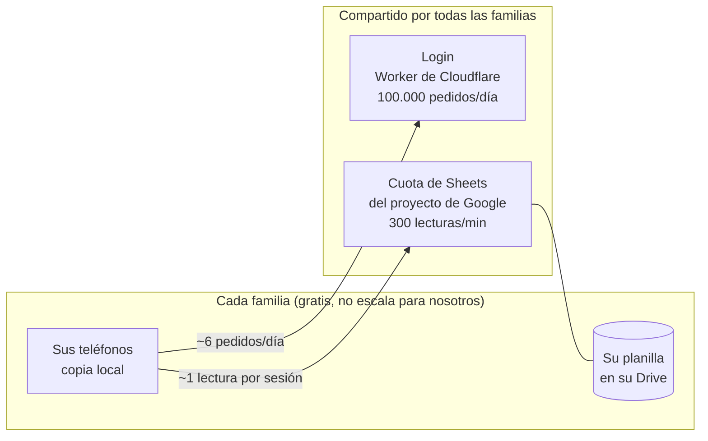

# Plan de escala: gratis y sin sobresaltos

> Decisión del 2026-10-15 ([PROPUESTA.md](../PROPUESTA.md) §1.1): la app se abre a otras familias, **gratis y sin cobrarles mantenimiento**. Se esperan menos de 1.000 familias, pero se diseña a gran escala para no tener sobresaltos.
> Las cifras de capacidad son **estimaciones** (la cuenta está abajo, con sus supuestos). Los límites de cada servicio son **oficiales**, con link y fecha de consulta.

## Los cuatro sobresaltos y su defensa

| Sobresalto                              | Defensa                                                                                                                                                   |
| --------------------------------------- | --------------------------------------------------------------------------------------------------------------------------------------------------------- |
| **Que llegue una factura**              | Ninguna cuenta con tarjeta ni facturación (Cloudflare Free, Google sin cuenta de facturación). Lo peor que puede pasar es que ande más lento              |
| **Que se caiga para todos**             | Límites que se reinician solos y rápido (el login, a medianoche UTC), y una app que guarda en el teléfono y sube cuando puede                             |
| **Tener que mudarse con miles adentro** | La mudanza a Cloudflare se hace ahora, con dos usuarios. Sin dominio propio, un cambio futuro de proveedor obliga a reinstalar una vez (sin perder datos) |
| **Un cambio roto que le llega a todos** | Sitio de prueba gratis (rama `dev`, planilla aparte) antes de pasar a producción                                                                          |

## Qué es de cada familia y qué es compartido

Los datos **nunca** cuestan: cada familia usa los 15 GB gratis de su Drive. Lo que se comparte es el login y la cuota de lecturas de Sheets, que es **el techo duro**.

## Capacidad estimada

**Supuestos:** una familia tiene 2 personas que abren la app 3 veces por día (6 sesiones). Cada sesión renueva el login una vez. El 15 % de las sesiones del día cae en la hora pico, y dentro de esa hora se reparten parejo; como la realidad es más despareja, se toma la mitad de lo que da la cuenta.

| Recurso                        | Límite gratis (oficial)                                                                                                                                        | Uso por familia                                              | Alcanza para                       |
| ------------------------------ | -------------------------------------------------------------------------------------------------------------------------------------------------------------- | ------------------------------------------------------------ | ---------------------------------- |
| Archivos de la app             | **Ilimitados** ([Cloudflare](https://developers.cloudflare.com/workers/static-assets/billing-and-limitations/), 2026-10-15)                                    | —                                                            | sin límite                         |
| Login (Worker)                 | **100.000 pedidos por día** ([Cloudflare](https://developers.cloudflare.com/workers/platform/pricing/), 2026-10-15)                                            | ~6 por día                                                   | **~16.000 familias**               |
| Lecturas de Sheets             | **300 por minuto por proyecto**; un pedido con varios rangos cuenta como uno ([Google](https://developers.google.com/workspace/sheets/api/limits), 2026-10-15) | ~1,2 por sesión (antes ~7)                                   | **~8.000 familias** (antes ~1.500) |
| Lecturas de Sheets por persona | 60 por minuto por persona                                                                                                                                      | ~1 por sesión                                                | sin problema                       |
| Consultas a Drive              | 1.000.000 de unidades por minuto por proyecto ([Google](https://developers.google.com/workspace/drive/api/guides/limits), 2026-10-15)                          | ~1 por pasada (+1 por chico que solo carga, en la del dueño) | sin problema                       |

Cuenta de Sheets: familias × 6 sesiones × 15 % × 1,2 lecturas ÷ 60 minutos = familias × 0,018 lecturas por minuto en el pico. 300 ÷ 0,018 ≈ 16.700, y la mitad por desparejo ≈ **8.000 familias**.

## Fase 1 · Cimientos (hecha el 2026-10-15)

| Qué                                                                                                                  | Para qué                                                                        |
| -------------------------------------------------------------------------------------------------------------------- | ------------------------------------------------------------------------------- |
| Login como Worker de Cloudflare (`servidor/`, `wrangler.jsonc`), app como archivos estáticos                         | Al pasarse del límite falla solo el login hasta el otro día; publicar no cuesta |
| Sitio de prueba (`prueba`, rama `dev`, planilla aparte)                                                              | Probar antes de que un cambio llegue a todas las familias                       |
| Sincronización con pocas lecturas: un pedido por pasada, versión de Drive antes de leer, sin releer después de subir | Una sesión típica pasa de ~7 lecturas de Sheets a ~1                            |
| Espera creciente con azar ante errores de Google (2 a 30 minutos)                                                    | Que miles de teléfonos no reintenten todos juntos y empeoren una saturación     |
| Vincular la planilla aunque el selector no ande en el iPhone                                                         | Menos soporte: es lo primero que traba a una familia nueva                      |
| Privacidad para una app abierta                                                                                      | Google la pide para publicar el login                                           |

Pendiente del dueño: la mudanza ([`MIGRACION.md`](MIGRACION.md)) y los opcionales de abajo.

## Fase 2 · Crecer: umbrales y qué hacer

No se hace nada hasta que un número lo pida. **Revisión mensual de 5 minutos** (el día 1 de cada mes):

| Señal                                        | Dónde mirarla                                                                                                | Umbral (70 %)                      | Qué hacer                                                                  | Costo                  |
| -------------------------------------------- | ------------------------------------------------------------------------------------------------------------ | ---------------------------------- | -------------------------------------------------------------------------- | ---------------------- |
| Pedidos al login por día                     | Cloudflare → Workers & Pages → `app` → **Metrics**                                                           | 70.000 por día                     | Pasar a **Workers Paid** (10 millones de pedidos por mes)                  | USD 5/mes              |
| Lecturas de Sheets por minuto (pico)         | Google Cloud → APIs & Services → **Google Sheets API → Quotas & System Limits** → _Read requests per minute_ | 210 por minuto                     | Pedir más cuota desde esa misma pantalla (_Edit quota_)                    | Gratis, no garantizado |
| Errores 429 de Sheets                        | Google Cloud → APIs & Services → **Google Sheets API → Metrics** (errores por código)                        | 429 en varios días                 | Lo mismo que la fila anterior                                              | Gratis                 |
| Google publica el precio por exceso de cuota | Mail de Google Cloud al dueño del proyecto (avisan con 90 días)                                              | —                                  | Decidir con el precio en la mano: pagar el exceso u optimizar más (Fase 3) | Hoy desconocido        |
| Consultas de soporte                         | El Gmail de la app                                                                                           | Más de las que se pueden contestar | Sumar ayuda en la app para la duda que más se repite                       | —                      |

> Mientras no haya cuenta de facturación, exceder la cuota de Google **no cobra nada**: los pedidos fallan con 429, la app espera y reintenta, y lo cargado queda en el teléfono.

## Fase 3 · Decenas de miles de familias

El techo pasa a ser la cuota de Sheets **por proyecto**. No se gambetea repartiendo familias en varios proyectos de Google: sus condiciones prohíben intentar esquivar los límites, y para pasarlos hace falta su permiso ([Google APIs Terms of Service](https://developers.google.com/terms), §2(d), consultado 2026-10-15). Las palancas, en orden:

1. **Leer solo lo nuevo:** pedir las filas desde la última conocida en vez de la planilla entera, y "Archivar año" para achicarla.
2. **Más cuota de Google**, con cuenta de facturación si para entonces Google cobra el exceso.
3. **Otra arquitectura** (base de datos propia): significa custodiar datos financieros de muchas personas y un costo que crece con cada familia. A esa altura la app ya es un producto, y conviene otra conversación.

## Opcionales (cuando quieran)

- **Gmail propio de la app** (una cuenta nueva, solo para esto) como _User support email_ en Google Auth Platform → Branding. Así las familias no ven el Gmail personal de Nico.
- **Verificación de marca** en Google (gratis): muestra el nombre y el logo de la app al entrar. Pide verificar el dominio en Search Console; con la dirección gratis de Cloudflare no sabemos si se puede (`PENDIENTES-ABIERTOS.md` #17).
- **Dominio propio:** se paga por año. Hace que un cambio futuro de proveedor sea invisible para las familias.

## Otras formas de guardar los datos (comparadas el 2026-10-18)

Hoy cada familia usa su propio Drive y lo único compartido es la cuota de Sheets. Si se guardara en
una base propia, los límites gratis serían de toda la app (`oficial`, páginas de precios
consultadas el 2026-10-18):

| Opción                                                                                                                  | Límite gratis                                                                        | Lo primero que se acabaría                                                                                                                           |
| ----------------------------------------------------------------------------------------------------------------------- | ------------------------------------------------------------------------------------ | ---------------------------------------------------------------------------------------------------------------------------------------------------- |
| Google Sheets (hoy)                                                                                                     | 15 GB del Drive de cada familia; 300 lecturas por minuto compartidas                 | La cuota de Sheets: unas 8.000 familias                                                                                                              |
| [Cloudflare D1](https://developers.cloudflare.com/d1/platform/pricing/)                                                 | 10 bases de 500 MB (5 GB); 5 millones de filas leídas y 100.000 escritas por día     | Los [100.000 pedidos por día del Worker](https://developers.cloudflare.com/workers/platform/limits/) que tendría en el medio: 2.000 a 4.000 familias |
| [Durable Objects](https://developers.cloudflare.com/durable-objects/platform/pricing/) (SQLite)                         | 100.000 pedidos, 5 millones de filas leídas y 100.000 escritas por día, 5 GB         | Los mismos pedidos                                                                                                                                   |
| [Supabase](https://supabase.com/pricing)                                                                                | 500 MB de base, 5 GB de tráfico por mes, 2 proyectos; se pausa tras 1 semana sin uso | El espacio: unas 1.000 familias durante un año                                                                                                       |
| [Firebase Firestore](https://firebase.google.com/pricing) (Spark)                                                       | 1 GiB, 50.000 lecturas y 20.000 escrituras por día                                   | Las lecturas: unos pocos cientos de familias                                                                                                         |
| [Turso](https://turso.tech/pricing), [Neon](https://neon.com/pricing), [MongoDB Atlas](https://www.mongodb.com/pricing) | 5 GB / 1 GB / 512 MB                                                                 | Necesitan un servidor en el medio: el mismo techo del Worker                                                                                         |

Las capacidades son estimaciones (`hipótesis`). La que se planeó, por si se decide, es D1:
`docs/PLAN-D1.md`.

## Lo que todavía es hipótesis

Ver `docs/PENDIENTES-ABIERTOS.md`: que Drive suba la versión enseguida al cambiar la planilla (#13; si no, el atraso máximo es de unos 12 minutos con la app abierta), cuánto procesador usa cada login en Cloudflare (#14) y que el permiso de cada cuenta sobre su planilla sobreviva a la mudanza (#16).
