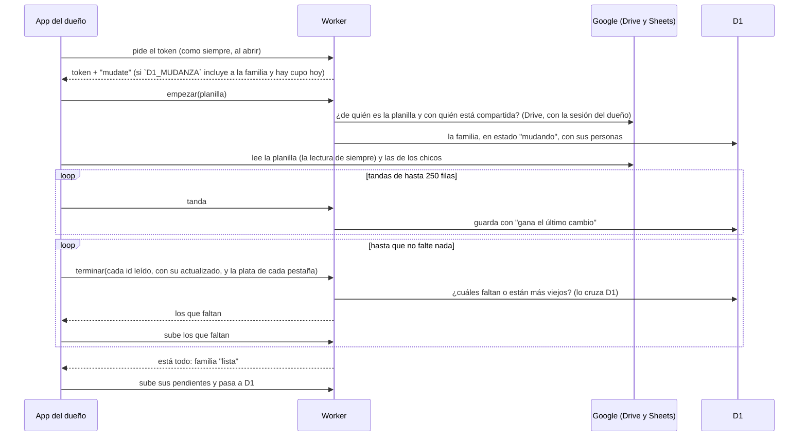

# Plan: los datos en Cloudflare D1

> **Estado (2026-10-22): EN PAUSA.** Muchas familias le dijeron al usuario que les gusta la app como
> está, con su planilla. La mudanza queda para el futuro, o se descarta. Lo hecho (las Fases 0 y 1,
> y las tablas de la Fase 2) quedó en la rama `Migracion-db-D1-cloudflare`, en GitHub. No se toca sin pedido del
> usuario. La base `gastos-familiares` sigue en Cloudflare, con las tablas vacías.
>
> Antes de la pausa: **decidida (2026-10-21).** El usuario pidió el plan completo, por fases, hasta que la app
> no use más Drive, trabajando en la rama `Migracion-db-D1-cloudflare` y mergeando cada fase terminada. **📍 Estamos en la
> Fase 0** (§8.0). Reemplaza al plan del 2026-10-18. Hay un motivo nuevo, y es el principal: con el
> Google del dueño lleno, la familia no puede cargar nada, y a una usuaria ni siquiera la dejó crear
> la planilla (`PENDIENTES-ABIERTOS.md` #29). Lo que pidió el usuario:
>
> - que sea **todo gratis**;
> - pensado para **menos de 2.000 personas** ("no va a llegar ni loco");
> - **sin perder los datos** de las familias que ya la usan.
>
> Lo que configura el usuario en Cloudflare, fase por fase, está en [`SETUP-D1.md`](SETUP-D1.md).
> El estado de cada fase vive en `PROPUESTA.md` §17 (Fase 11).

## 1. Por qué

- **El Google lleno del dueño.** La planilla vive en el Drive del dueño y usa su espacio: los
  15 GB gratis que comparte con Gmail y Fotos. Sin espacio, nadie de la familia puede escribir.
  Lo cargado queda esperando en cada teléfono (hoy la app lo explica: `sin-espacio`), y una familia
  nueva no puede ni empezar. Con D1, los datos no ocupan el espacio de nadie: el problema
  **desaparece**, ya no hay que manejarlo.
- **Los invitados.** Hoy cada invitado confirma la planilla en el selector de Google una vez. Con
  D1 solo **entra con Google**: no hay planilla, ni selector, ni mail de Drive.
- **Los chicos que solo cargan.** Hoy cada uno tiene una planilla aparte que copia la app del
  dueño (`dominio-gastos.md` §7.6), y lo suyo llega recién cuando el dueño abre la app. Con D1 es
  un rol más, y llega en la próxima pasada.
- **Menos permisos de Google** para las familias nuevas: solo `openid` y `email`.

## 2. Qué cambia y qué no

| Cambia                                                                                                                                               | No cambia                                                                                 |
| ---------------------------------------------------------------------------------------------------------------------------------------------------- | ----------------------------------------------------------------------------------------- |
| Los datos viven en D1, en la cuenta de Cloudflare de la app: es lo contrario de `PROPUESTA.md` §1.1 y del chasis §4, por eso se decidió aparte (§10) | Primero el teléfono: copia en IndexedDB, pendientes con relojito, "gana el último cambio" |
| El Worker, además del login, guarda y entrega los datos (`/api/datos/*`)                                                                             | La interfaz `Repositorio` y todo `domain/`                                                |
| Invitar es un link con un código, sin compartir nada en Drive                                                                                        | Se entra con Google: la identidad sigue siendo la cuenta de Google                        |
| "Abrir la planilla" pasa a ser "Exportar" (CSV)                                                                                                      | Gratis: plan gratis de Workers, sin tarjeta                                               |
| Lo que se cuida pasa de "lecturas de Sheets" a "pedidos al Worker y filas de D1" (en los tests, `pedidosAlWorker()`)                                 | La planilla de cada familia que ya existe: **no se toca ni se borra** (§6)                |
| La política de privacidad (`public/privacidad.html`) y las invariantes del chasis §4                                                                 | Las reglas de la familia: dueño, integrantes, chicos que solo cargan y quién puede qué    |

## 3. Límites gratis (`oficial`)

Consultados el 2026-10-18 y vueltos a mirar el 2026-10-21.

| Qué               | Límite gratis                                                                                                                                                                               | Fuente                                                                                                                                                   |
| ----------------- | ------------------------------------------------------------------------------------------------------------------------------------------------------------------------------------------- | -------------------------------------------------------------------------------------------------------------------------------------------------------- |
| Pedidos al Worker | 100.000 por día en toda la app, y 10 ms de CPU por pedido (esperar a D1 o a Google no cuenta). Al pasarse, error hasta las 00:00 UTC. Los archivos de la app no cuentan (`ESCALA.md`)       | <https://developers.cloudflare.com/workers/platform/limits/>                                                                                             |
| D1: filas         | 5 millones leídas y 100.000 escritas por día, en toda la cuenta. **Desde el 2026-09-01, al pasarse, D1 devuelve error** hasta las 00:00 UTC (las 21 h en Argentina). Lo guardado no se toca | <https://developers.cloudflare.com/d1/platform/pricing/> y <https://developers.cloudflare.com/changelog/post/2026-09-01-d1-free-tier-limit-enforcement/> |
| D1: qué cuenta    | Se cuentan las filas **recorridas**, no las devueltas: sin índice, una consulta recorre la tabla entera. Cada índice que toca una escritura suma una fila escrita más                       | <https://developers.cloudflare.com/d1/best-practices/use-indexes/> y <https://developers.cloudflare.com/workers/platform/pricing/>                       |
| D1: espacio       | 10 bases, de 500 MB cada una, y 5 GB en total (consultado el 2026-10-18)                                                                                                                    | <https://developers.cloudflare.com/d1/platform/limits/>                                                                                                  |
| D1: por pedido    | 50 consultas por invocación, 100 parámetros por consulta y filas de hasta 2 MB (consultado el 2026-10-18)                                                                                   | <https://developers.cloudflare.com/d1/platform/limits/>                                                                                                  |
| Respaldo          | Time Travel: volver a cualquier momento de los últimos **7 días**                                                                                                                           | <https://developers.cloudflare.com/d1/reference/time-travel/>                                                                                            |

## 4. Cuánto aguanta, con el techo del usuario

Supuestos (`hipótesis`, se miden en la Fase 1):

- 2.000 personas, de a 2,5 por familia: **800 familias**.
- Cada persona hace de 10 a 20 pasadas por día: al abrir, después de cargar, al volver a la app, y
  cada 5 minutos con la app a la vista.
- Cada familia suma de 1.500 a 5.000 movimientos por año (`PROPUESTA.md` §15 estima 5.000, con
  cuotas e ingresos), unos 270 bytes cada uno con su índice (medido, §4.2).

| Recurso           | Con 800 familias                                                                                                                                                                               | Límite gratis                  | Uso                                                       |
| ----------------- | ---------------------------------------------------------------------------------------------------------------------------------------------------------------------------------------------- | ------------------------------ | --------------------------------------------------------- |
| Pedidos al Worker | 20.000 a 40.000 por día                                                                                                                                                                        | 100.000 por día                | 20 a 40 %                                                 |
| Filas leídas      | Una pasada sin novedades lee **unas pocas filas** (el máximo de cada tabla, por el índice); con novedades, solo lo que cambió; un teléfono nuevo baja la familia entera una vez. ≈ 500.000/día | 5 millones por día             | ~10 %                                                     |
| Filas escritas    | Un día común, ~25 por familia; un día cargado, ~160 (§4.1). ≈ 20.000 en un día común                                                                                                           | 100.000 por día                | ~20 % un día común; **el más justo** (§4.1)               |
| Espacio           | 0,4 a 1,35 MB por familia por año (medido: ~270 bytes por movimiento): de 320 MB a 1,1 GB por año                                                                                              | 500 MB por base, 5 GB en total | una base dura de 5,5 a 19 meses; las 10, de 4,5 a 15 años |

**Lo que no puede pasar: que llegue una factura.** La cuenta de Cloudflare no tiene tarjeta
(`ESCALA.md`), así que pasarse no cobra nada: D1 y el Worker devuelven error hasta las 00:00 UTC
(§5.6). Lo peor que pasa es que ese día la app ande como "sin señal" hasta las 21 h. Si algún día
hiciera falta más, pagar es una decisión aparte: el escalón es el plan pago de Workers (USD 5 por
mes según `PROPUESTA.md` §16; el precio se verifica en la página de Cloudflare cuando haga falta).

**Conclusión:** para el techo del usuario alcanza, pero el límite que se mira es el de **filas
escritas**, y hay dos momentos justos:

- **La mudanza.** Pasar una familia con 3.000 movimientos escribe unas 6.000 filas. Mudar todas el
  mismo día agotaría las 100.000 y dejaría a **todas** las familias sin poder subir nada hasta las
  21 h. Por eso la mudanza va de a poco (§6.6).
- **Un día cargado para muchas familias a la vez** (principio de mes, Hot Sale), con 800 familias
  (§4.1).

A favor: la app tiene pocas semanas en producción, así que las familias de hoy tienen poco
cargado. **Cuanto antes se mude, más barato sale.**

El espacio es el otro techo, a muy largo plazo. Las palancas, en orden: archivar los años
cerrados (§5.7), achicar las filas (fechas como números, `quien` como número de persona), y recién
después el plan pago.

### 4.1 Las filas escritas, en detalle (pregunta del usuario, 2026-10-21)

**De dónde salen.** En esta app todas las escrituras las hace una persona: cargar, editar, borrar,
pagar un fijo, cambiar un ajuste. No hay nada que escriba solo, y una pasada sin cambios no escribe
nada (solo lee). Cada movimiento guardado cuesta **2 filas**: la tabla y el índice de `cambio`
(`oficial`, §3). No hay más: el número de `cambio` sale del índice, sin una fila de contador que
se escriba en cada pasada (§4.1, punto 3).

| Acción                                  | Movimientos | Filas escritas |
| --------------------------------------- | ----------- | -------------- |
| Cargar un gasto o un ingreso            | 1           | 2              |
| Pagar un fijo                           | 1           | 2              |
| Cambiar un ajuste (tarjeta, meta…)      | 1 fila      | 2              |
| Compra en 12 cuotas                     | 12          | 24             |
| Compra en 60 cuotas (el máximo de hoy)  | 60          | 120            |
| Editar o borrar una compra en 12 cuotas | 12          | 24             |

**Las cuotas son lo que más pesa**, porque cada cuota es un movimiento (`dominio-gastos.md` §3).

**Un día de una familia** (`hipótesis`, se mide en la Fase 1):

- **Común, ~25 filas:** 8 gastos, media compra en cuotas, un fijo y una corrección.
- **Cargado, ~160 filas:** 30 gastos, 3 compras en 12 cuotas, 10 fijos y unas correcciones. Por
  ejemplo, principio de mes o el día que se carga el resumen de la tarjeta.

**Cuántas familias entran en 100.000:**

| Escenario                                                   | Filas del día   | ¿Entra?         |
| ----------------------------------------------------------- | --------------- | --------------- |
| 100 familias, todas con un día cargado                      | 16.000          | Sí, sobra       |
| 800 familias, día común                                     | 20.000          | Sí (20 %)       |
| 800 familias, el 40 % con un día cargado (principio de mes) | 51.000 + 12.000 | Sí (63 %)       |
| 800 familias, todas con un día cargado (Hot Sale)           | 128.000         | **No**          |
| Día común: el máximo de familias                            | 100.000 ÷ 25    | ~4.000 familias |
| Día cargado para todas: el máximo de familias               | 100.000 ÷ 160   | ~625 familias   |

O sea: **con unos pocos cientos de familias no hay forma de llegar**. Con 800, un día muy cargado
para casi todas a la vez sí puede pasarse.

**Qué pasa si se pasa.** No se pierde nada, pero se nota:

- desde ese momento y hasta las 21 h (hora argentina), las escrituras fallan y la app las trata
  como sin señal: cada teléfono sigue cargando, y lo cargado queda pendiente;
- Mica no ve lo que cargó Nico hasta las 21 h, cuando todo se sube solo;
- si las lecturas siguen andando con el cupo de escrituras agotado es `hipótesis` (los mensajes de
  error de D1 son distintos para cada cupo);
- Cloudflare manda un mail cuando se llega al límite (`oficial`, changelog del 2026-09-01).

Hoy, con Sheets, este riesgo no existe: cada familia escribe en su planilla, y el cupo compartido
de Google se cuenta por minuto, no por día. **Es el costo real de pasar a D1**, y por eso se
defiende:

1. **Un tope por familia** (unas 10 veces un día cargado). Una app trabada o con un bug en un
   teléfono no puede gastarse el cupo de todas: al llegar al tope, esa familia queda como sin señal
   hasta el otro día, y las demás ni se enteran. Se lleva sin escribir en cada pasada: la familia
   anota **una vez por día** desde qué `cambio` arrancó, y como cada pasada que escribe sube el
   `cambio` en uno, la resta dice cuántas veces escribió hoy. Con un tope de filas por pasada, eso
   acota el día. Los números exactos, en la Fase 2.
2. **Un reintento que no cambia nada no escribe:** el "gana el último cambio" no toca la fila si
   no es más nueva, y D1 cuenta 0 filas escritas (medido, §4.2). Los reintentos y el barrido
   (§6.5) gastan lecturas, no escrituras.
3. **Sin fila de contador (ya en el diseño, §5.2).** El `cambio` nuevo es el máximo de la familia
   más uno, calculado dentro de la misma consulta que guarda. Ahorra una fila por pasada (un gasto
   pasa de 3 filas a 2) y es solo del servidor: **la app no se entera**. Probado en SQLite local
   (`empírico`, 2026-10-21): todas las filas de una pasada reciben el mismo número, un reintento
   que no cambia nada no lo mueve, y el máximo se lee con el índice (`SEARCH … USING COVERING
INDEX`). En D1 se confirma en la Fase 1.
4. **Las cuotas como una sola fila: no ahora; después de D1, de la forma segura** (pregunta del usuario: ¿pone en
   riesgo la app?, ¿se puede hacer antes de D1?):
   - Hoy cada cuota tiene **guardados** su id, su fecha y su monto; la última se lleva el resto de
     los centavos (`domain/cuotas.ts`). El balance, las tarjetas, la proyección, la Lista y "borrar
     solo las que faltan" trabajan cuota por cuota (`domain/movimientos.ts`, `idsDeCompra`).
   - Con una sola fila, las cuotas se **recalculan** cada vez que se leen. Si la regla cambia, las
     compras viejas se recalculan distinto: plata que cambia de mes sin que nadie la toque. Ya pasó
     una vez: el 2026-10-16, la primera cuota pasó a caer el mes siguiente. Para evitarlo hay que
     guardar cada parámetro y congelar el cálculo, y "borrar solo las que faltan" queda como
     excepción aparte. Es tocar el corazón de la plata.
   - **Con Sheets no ahorra nada:** agregar 12 filas es un solo pedido a Google. El beneficio
     existe solo en D1, así que hacerlo antes de la mudanza es puro riesgo.
   - La forma segura es **no recalcular**: una fila por compra, con las cuotas **ya calculadas**
     (id, fecha y monto de cada una) guardadas en una columna JSON. Se hace después de la mudanza,
     cuando Drive ya no existe (Fase 8).
5. **Si un día no alcanza:** el plan pago de Workers incluye 50 millones de filas escritas por mes
   (`oficial`, <https://developers.cloudflare.com/workers/platform/pricing/>), unas 1,6 millones por
   día. Pagar es una decisión aparte del usuario.

**¿Y guardar en otra base ese día y pasarlo a D1 al otro?** (pregunta del usuario, 2026-10-21)

- **En el teléfono ya es así.** Cada teléfono tiene su base local (IndexedDB, el SQLite del
  navegador). Si D1 corta, todo queda ahí como pendiente y se sube solo a las 21 h. Eso ya existe
  y no se pierde nada.
- **Lo que no resuelve es compartir.** Mientras D1 está cortado, Mica no ve lo de Nico. Para eso
  haría falta una segunda base **en el servidor**, donde escriban los dos teléfonos.
- **La única gratis que sirve es el SQLite de un Durable Object**, con los mismos cupos que D1
  (`oficial`, <https://developers.cloudflare.com/durable-objects/platform/pricing/>). KV tiene
  1.000 escrituras por día: no sirve. Si el cupo del Durable Object es aparte del de D1 o es el
  mismo, Cloudflare no lo dice claro: es `hipótesis`. Si es el mismo, no sirve de nada.
- **Por ahora no conviene, aunque el cupo sea aparte:**
  1. Es una segunda base que también hay que leer: cada pasada tendría que juntar D1 con la de
     respaldo para que Mica vea lo de Nico.
  2. Pasar lo guardado a D1 al otro día **gasta el cupo del otro día**. Cada fila se escribe dos
     veces, y si el pico fue por algo de todos (Hot Sale), el día siguiente arranca debiendo.
  3. Solo haría falta con cientos de familias en un día cargado a la vez, y aun así no se pierde
     nada.
- **Primero van las palancas:**
  - sin fila de contador (punto 3): ya está en el diseño y no toca la app. Un día cargado baja de
    ~200 filas a ~160;
  - las cuotas como una fila (punto 4), solo si hace falta y con su riesgo: un día cargado bajaría
    a ~100, y entrarían las 800 familias aunque todas tengan un día cargado a la vez (~77.000
    filas).

  Si aun así las métricas muestran que no alcanza, se reconsidera la base de respaldo.

- **"Juntar la subida"** (esperar unos segundos más y subir varios cambios juntos) se descartó:
  ahorraba la misma fila de contador que el punto 3, pero con un costo en la app. No pierde datos
  (todo se guarda primero en el teléfono), pero lo cargado tarda más en llegar a los demás, y en el
  iPhone, si se cierra la app enseguida (el flujo del helado), recién sube cuando se vuelve a
  abrir. Hoy sube a los 1,5 segundos (`ESPERA_ANTES_DE_SUBIR_MS`) y conviene que siga así.

### 4.2 Lo medido en la Fase 1 (2026-10-22)

`empírico`. Cómo: un Worker de prueba (`d1-prueba`) sobre la base `gastos-familiares`, con 2.501
movimientos inventados del tamaño de uno real. Las filas, de lo que informa D1 en cada respuesta
(`meta`); la CPU, de `wrangler tail` (`cpuTime`); la latencia, con `curl` desde la compu del
usuario. Al terminar se borraron el Worker y las tablas.

| Qué                                             | Medido                                                                                                                                                                                          | Contra el plan                               |
| ----------------------------------------------- | ----------------------------------------------------------------------------------------------------------------------------------------------------------------------------------------------- | -------------------------------------------- |
| Agregar un movimiento                           | 2 filas escritas, 2 leídas                                                                                                                                                                      | Como se esperaba                             |
| Cambiarlo (un `actualizado` más nuevo)          | 2 escritas, 3 leídas                                                                                                                                                                            | Como se esperaba                             |
| Reintento igual, o una versión más vieja        | **0 escritas**, 3 leídas, y no pisa nada                                                                                                                                                        | Era `hipótesis`: confirmado                  |
| 500 movimientos en un parámetro JSON (180 KB)   | 1.000 escritas; CPU de 4 a 9 ms                                                                                                                                                                 | Entra                                        |
| 2.000 en un parámetro (720 KB)                  | 4.000 escritas; CPU 25 ms                                                                                                                                                                       | D1 lo acepta, pero pasa los 10 ms            |
| El máximo de `cambio` (la pasada liviana)       | 1 fila leída; CPU de 1 a 2 ms                                                                                                                                                                   | Como se esperaba                             |
| Pedir "lo nuevo" sin novedades                  | 1 fila leída                                                                                                                                                                                    | Como se esperaba                             |
| Una página de 500 para bajar                    | 500 leídas; CPU 6 ms; 200 KB                                                                                                                                                                    | Entra                                        |
| Páginas de 1.000 y de 2.500                     | CPU 8 y 21 ms                                                                                                                                                                                   | Más de 500 por página, no                    |
| Cruce id por id de 500 y de 2.000 claves (§6.2) | 1.003 y 4.003 leídas; CPU 3 y 4 ms; encontró justo las 3 que faltaban y las 2 viejas                                                                                                            | Entra                                        |
| Espacio                                         | ~270 bytes por movimiento, con su índice                                                                                                                                                        | Se estimaban 350                             |
| Rate limiting de Workers                        | Se publicó y anduvo en el plan gratis                                                                                                                                                           | Era `hipótesis`: confirmado                  |
| `count(*)`                                      | Recorre la tabla entera: 2.501 filas leídas para contar 2.501                                                                                                                                   | Nunca en una pasada                          |
| Latencia                                        | El Worker corre en Buenos Aires (EZE) y D1 contesta desde Chicago (ORD): ~200 ms por consulta. Una pasada liviana, de punta a punta: 0,3 a 0,4 s (a veces ~1 s); el Worker solo, sin D1: 0,08 s | No se nota: se guarda primero en el teléfono |

La CPU de las subidas incluye armar los datos de prueba dentro del Worker; en la app los manda el
teléfono, así que debería ser parecida o menor.

**Ajustes al diseño que salen de esto:**

- **Subidas en tandas de hasta 250 filas** (la mudanza y cualquier pasada grande), páginas de
  bajada de 500, y el cruce de la mudanza en tandas de 500.
- **El tope por persona, con el binding de rate limiting** (§5.3).
- **Nunca `count(*)` ni nada que recorra una tabla en una pasada.**

**Lo que no se pudo medir:**

- Si se puede leer con el cupo de escrituras agotado: habría que agotarlo. No cambia el diseño:
  igual se trata como sin señal (§5.6).
- Que el servidor vea el dueño y los permisos de una planilla con `drive.file` (PENDIENTES #3):
  necesita Google y la sesión de un dueño. Se prueba en la Fase 5.
- Los pedidos reales por día y cuántas familias usan la app: los pasa el usuario.

**Veredicto: sí.** Nada de lo medido rompe el diseño, y la Fase 2 puede arrancar con estos ajustes.

## 5. Diseño

### 5.0 Multi-tenant: una base para todas las familias

Es una base **multi-tenant**: todas las familias comparten las mismas tablas, y cada fila lleva su
`familia_id`.

| Forma                                              | Gratis                                           | Elegida                                                 |
| -------------------------------------------------- | ------------------------------------------------ | ------------------------------------------------------- |
| Una base compartida, con `familia_id` en cada fila | Sí                                               | **Sí**                                                  |
| Una base D1 por familia                            | No: el plan gratis da 10 bases en toda la cuenta | No                                                      |
| Un Durable Object con su SQLite por familia        | Sí                                               | No (§11): más código, para una escala que no hace falta |

La regla que lo hace seguro: **la familia sale siempre de la sesión, nunca del teléfono.**

- El Worker averigua la familia con el email de la cookie (`personas`).
- Toda consulta lleva `WHERE familia_id = ?` con ese valor, y la clave de cada tabla empieza por
  `familia_id`: lo que el teléfono mande en `familia_id` se ignora.
- Un test por endpoint verifica que una cuenta de otra familia no lee ni escribe nada ajeno, ni
  aunque adivine un `id`.

### 5.1 Tablas

```sql
-- Una fila por familia. No lleva contador: el `cambio` de cada fila sale del índice (§5.2).
-- `planilla_id` y `estado` son para la mudanza (§6).
CREATE TABLE familias (
  id INTEGER PRIMARY KEY, nombre TEXT NOT NULL, creada TEXT NOT NULL,
  dia TEXT, cambio_al_empezar_el_dia INTEGER,  -- el tope por familia (§4.1), una vez por día
  base INTEGER NOT NULL DEFAULT 0,   -- en qué base D1 están sus datos (§5.5)
  planilla_id TEXT UNIQUE,           -- la planilla de la que vino (null: nació en D1)
  estado TEXT NOT NULL,              -- 'mudando' | 'lista'
  mudando_hasta TEXT,                -- un teléfono está mudando: los demás esperan (§5.8)
  barrido_hasta TEXT,                -- hasta cuándo se mira la planilla vieja (§6.5)
  borrada TEXT                       -- el dueño la borró: se borra de verdad a los 30 días
);

-- Quiénes son y qué pueden. El email va normalizado con `claveDeCuenta` (domain/cuentas.ts).
CREATE TABLE personas (
  familia_id INTEGER NOT NULL, email TEXT NOT NULL, apodo TEXT, color INTEGER,
  rol TEXT NOT NULL,                 -- 'dueño' | 'integrante' | 'chico'
  planilla TEXT,                     -- la planilla propia de un chico, para su mudanza (§6.3)
  entro TEXT, actualizado TEXT NOT NULL, borrado INTEGER NOT NULL DEFAULT 0,
  cambio INTEGER NOT NULL,
  PRIMARY KEY (familia_id, email)
) WITHOUT ROWID;
-- Una cuenta está en una sola familia a la vez, como hoy.
CREATE UNIQUE INDEX persona_por_email ON personas (email) WHERE borrado = 0;

-- Las columnas de la pestaña Movimientos, más `chico` (lo cargó un chico que solo carga: va
-- aparte del balance, como hoy "De los chicos") y `cambio`. El `id` es el del teléfono: la clave
-- es (familia, id), así un id repetido en otra familia no la toca.
CREATE TABLE movimientos (
  familia_id INTEGER NOT NULL, id TEXT NOT NULL,
  tipo TEXT, fecha TEXT, monto INTEGER, categoria TEXT, nota TEXT, quien TEXT, medio TEXT,
  compra_id TEXT, cuota TEXT, tarjeta TEXT, fijo TEXT, etiqueta TEXT,
  creado TEXT, actualizado TEXT NOT NULL, borrado INTEGER NOT NULL DEFAULT 0,
  chico INTEGER NOT NULL DEFAULT 0, cambio INTEGER NOT NULL,
  PRIMARY KEY (familia_id, id)
) WITHOUT ROWID;
CREATE INDEX movimientos_por_cambio ON movimientos (familia_id, cambio);

-- Tarjetas, fijos, presupuestos, categorías, metas y ahorros: una tabla cada una, con las
-- columnas de su pestaña, `familia_id`, `cambio` y el mismo índice.

-- El código del link de invitación, para quién es y con qué rol.
CREATE TABLE invitaciones (
  codigo TEXT PRIMARY KEY, familia_id INTEGER NOT NULL, email TEXT NOT NULL,
  rol TEXT NOT NULL, vence TEXT NOT NULL, usada TEXT
);

-- Cuántas filas escribió la mudanza cada día (UTC), para no agotar el cupo de todos (§6.6).
CREATE TABLE mudanza_del_dia (dia TEXT PRIMARY KEY, filas INTEGER NOT NULL);

-- Una fila por login (los logins son pocos): la cookie lleva un id al azar, y sin esta fila no
-- sirve, aunque alguien tenga la clave con la que se cifran las cookies (§12, punto 7).
CREATE TABLE sesiones (id TEXT PRIMARY KEY, email TEXT NOT NULL, vence TEXT NOT NULL);

-- Las planillas que todavía están en Sheets y se usaron hace poco: la app del dueño la anota al
-- pedir el token, una vez por día. Dice cuántas familias faltan mudar (Fase 6, §12 punto 4).
CREATE TABLE planillas_vistas (planilla_id TEXT PRIMARY KEY, dia TEXT NOT NULL);
```

- La plata sigue en **centavos enteros** y las fechas como `AAAA-MM-DD`
  (`rules/10-react-pwa.md`).
- Las tablas se crean con `wrangler d1 migrations`, nunca desde el código de la app.

### 5.2 Un pedido por pasada

`POST /api/datos/sincronizar`, con `{ desde: cursor, cambios: [pendientes] }`. El Worker:

1. verifica la sesión y que el email sea una persona activa de su familia (1 fila leída);
2. si hay cambios, los aplica en **un solo `batch`** (es una transacción): guarda cada tabla con
   **"gana el último `actualizado`" dentro de la misma consulta**, y cada fila que cambia recibe
   como `cambio` el máximo de la familia más uno (sin fila de contador, §4.1);
3. si `desde` es igual al máximo `cambio` de la familia y no subió nada, responde "nada nuevo". Es
   la pasada liviana: **1 pedido y unas pocas filas leídas** (el máximo de cada tabla, por el
   índice);
4. si no, devuelve lo que cambió desde `desde`, usando el índice, en **páginas de hasta 500
   filas**, para no pasar los 10 ms de CPU. Si hay más, la respuesta dice que sigue.

Probado en SQLite local (Node 24, `node:sqlite`, `empírico` del 2026-10-21):

- todas las filas de una tabla entran en **un solo parámetro JSON** (`json_each`). Así no
  aparecen los topes de 100 parámetros ni de 50 consultas: entraron 2.000 movimientos de una;
- `ON CONFLICT (familia_id, id) DO UPDATE … WHERE excluded.actualizado > movimientos.actualizado`:
  una versión vieja no pisa a una nueva, y el mismo `id` en otra familia no se cruza;
- "lo que cambió" usa el índice (`SEARCH … USING COVERING INDEX`), sin recorrer la tabla.

Confirmado en D1 de verdad el 2026-10-22 (`empírico`, §4.2).

En el teléfono se reusa `data/sync/` (la cola, la fusión y la espera creciente): lo pendiente
sigue mandando. La respuesta trae el cursor nuevo, así que después de subir no hace falta volver a
leer.

### 5.3 Sesión, roles y seguridad

- **Login:** las familias nuevas entran con `openid email`. Las que vienen de Sheets siguen con
  `drive.file` hasta terminar el barrido (§6.5). La cookie de sesión cifrada sigue como hoy
  (`servidor/auth.ts`): ya trae el email que verificó Google.
- **Cada pedido verifica a la persona.** Quitar a alguien le corta el acceso en su próximo pedido.
- **El servidor hace cumplir los roles**, con los mismos permisos de hoy (`dominio-gastos.md` §5 y
  §7.6):
  - un chico solo escribe movimientos a su nombre, con `chico = 1`, y solo lee los suyos;
  - invitar, quitar y borrar la familia: solo el dueño.
- **El servidor valida cada fila** con lo mismo que usa la app (`data/validar.ts` y
  `domain/cuentas.ts` son puros: se comparten con `servidor/`). Una fila inválida se rechaza sola,
  sin tirar la pasada entera.
- **Topes:** un teléfono trabado no puede comerse el cupo diario de todas las familias.
  - Filas escritas por familia y por día: una anotación por día, sin filas extra por pasada (§4.1).
  - Pedidos por persona y por minuto: con el binding de rate limiting de Workers, que anda en el
    plan gratis y no gasta filas (`empírico`, §4.2). Cuenta por centro de datos y se puede pasar un
    poco (`oficial`, <https://developers.cloudflare.com/workers/runtime-apis/bindings/rate-limit/>,
    2026-10-22): alcanza para frenar una app trabada.
- Nunca se escriben datos de la familia en los logs (`rules/10-react-pwa.md` §7).

### 5.4 Invitar (sin planilla)

1. El dueño, en Familia → Invitar (apodo y Gmail), crea una invitación. El link es
   `/?invitacion=CODIGO&de=Nico` y se manda por WhatsApp, como hoy.
2. El invitado abre el link y ve la bienvenida. Al entrar con Google, el servidor compara su email
   con el de la invitación y lo suma a `personas`. **No hay segundo paso.**
3. Un chico se invita igual, con `rol = 'chico'`.
4. Quitar a alguien es `borrado = 1` en `personas`.
5. Los links viejos (`?unirse=<planilla>`) siguen andando: el servidor busca la familia por
   `planilla_id`, y si esa cuenta ya era de la familia, entra.

### 5.5 Las bases

Al principio hay una sola base (`DB0`), con todo adentro. Cuando pase de unos 400 MB, las familias
**nuevas** guardan sus datos en `DB1` (`familias.base = 1`), y para ellas cada pedido hace una
consulta más (`personas` sigue en `DB0`). Ninguna familia se muda de base.

### 5.6 Cuando se acaba el cupo del día

El error de cupo del Worker o de D1 se trata como **sin señal**:

- lo cargado queda en el teléfono como pendiente (eso ya existe);
- no aparece ningún aviso nuevo: se ve el relojito de pendiente de siempre, y todo sube solo
  cuando vuelve el cupo (a las 21 h, hora argentina). La mudanza es transparente (§6.1), y esto
  también.

Hay que mirar el uso en el panel de Cloudflare: al llegar al 70 % de cualquier cupo, se decide qué
hacer (`SETUP-D1.md`, Fase 6).

### 5.7 Respaldos, exportar, borrar y archivar

- **Time Travel:** cualquier momento de los últimos 7 días, gratis.
- **Sin copia fuera de Cloudflare** (§10, decisión 3): alcanzan Time Travel y lo que exporta cada
  familia.
- **Exportar desde la app:** CSV, siempre. Así cada familia se puede llevar sus datos, como hoy
  los tiene en su Drive. Mientras dura la mudanza (Fases 5 y 6), el dueño tiene además "Pasar a
  la planilla", el camino de vuelta (§6.7), que se va con Drive en la Fase 7.
- **Borrar la familia** (el dueño): queda marcada y se borra de verdad a los 30 días, con una tarea
  programada del Worker (el plan gratis trae 5). Se puede deshacer, como hoy la papelera de Drive.
- **Archivar:** cuando el espacio apriete, los años cerrados se exportan y se borran de la base.

### 5.8 Concurrencia: varios teléfonos a la vez

Lo que garantiza D1 (`oficial`, consultado el 2026-10-21):

- Cada base D1 es **un solo Durable Object**, y un Durable Object atiende de a una cosa por vez:
  las escrituras de toda la app quedan en fila, nunca se mezclan
  (<https://developers.cloudflare.com/d1/observability/debug-d1/>,
  <https://developers.cloudflare.com/workers/platform/storage-options/>).
- Un `batch` es **una transacción**: si falla una consulta, se deshace todo el `batch`
  (<https://developers.cloudflare.com/d1/worker-api/d1-database/>).
- Sin la Sessions API, **todo va a la base principal**, sin réplicas que puedan estar atrasadas
  (<https://developers.cloudflare.com/d1/best-practices/read-replication/>). No se usa la Sessions
  API.
- D1 **no reintenta las escrituras**: se pide que el reintento sea idempotente
  (<https://developers.cloudflare.com/d1/observability/debug-d1/>). El nuestro lo es (§5.2).

Cómo queda cada caso:

| Caso                                                           | Qué pasa                                                                                                                                                                                                                                                                     |
| -------------------------------------------------------------- | ---------------------------------------------------------------------------------------------------------------------------------------------------------------------------------------------------------------------------------------------------------------------------- |
| Nico y Mica cargan a la vez                                    | Son filas distintas (cada una con su `id`): entran las dos, en el orden en que llegan                                                                                                                                                                                        |
| Los dos editan **el mismo** movimiento                         | Gana el `actualizado` más nuevo, comparado **dentro** de la consulta (§5.2): no hay un "leer, comparar y escribir" en el Worker que otro pedido pueda pisar en el medio. Es la regla de hoy (`PROPUESTA.md` §9)                                                              |
| Uno sube mientras el otro baja                                 | El `cambio` nuevo se calcula **dentro** de la misma transacción que guarda las filas, y D1 las atiende de a una. Quien lee ve todo el `batch` o nada, y el cursor nunca saltea un cambio. Con fechas como cursor sí podría saltearse uno: por eso es un número que solo sube |
| Se corta la señal: ¿se guardó o no?                            | Se reintenta igual: el mismo `id` con el mismo `actualizado` no cambia nada. No hay duplicados                                                                                                                                                                               |
| Un teléfono con la hora muy adelantada                         | Ganaría siempre. El servidor rechaza un `actualizado` más de 1 día en el futuro, y la app le avisa a esa persona que revise la hora. Hoy, con Sheets, ese caso no tiene defensa                                                                                              |
| Dos teléfonos suman a la misma meta o al mismo ahorro a la vez | Gana el último y se pierde una suma: es lo de hoy (`dominio-gastos.md` §7.3). Con D1 se puede mejorar, mandando "sumá 5.000" en vez de "ahora son 25.000" (lo suma el servidor). Queda como mejora, no entra en la mudanza                                                   |
| Muchas familias a la vez                                       | Todas hacen fila en la misma base. Cada pasada son pocas consultas por índice, de milisegundos, así que para 800 familias no hay fila que se note (`hipótesis`: se mide en la Fase 1 con el tiempo que informa D1)                                                           |
| Dos teléfonos del dueño empiezan la mudanza a la vez           | `empezar` deja anotado quién está mudando, por 10 minutos, y al otro le contesta "ya se está mudando". Aunque corrieran los dos no se rompe nada: cada tanda se puede repetir; solo se gastaría el doble de filas                                                            |

## 6. La mudanza de las familias que ya usan Sheets

### 6.1 Las reglas que no se negocian

1. **La planilla no se borra ni se cambia,** ni siquiera el `Léeme`. Queda como respaldo de solo
   lectura.
2. **Es transparente para las familias** (pedido del usuario, 2026-10-21): no hay aviso, pantalla
   ni mensaje de la mudanza, ni en la app ni en la planilla. Nadie tiene que hacer nada, ni
   enterarse.
3. **Pasar una familia se puede repetir.** Cada fila entra por su `id`, con "gana el último
   `actualizado`" (§5.2). Si se corta a mitad, se vuelve a correr desde el principio, sin duplicar
   ni pisar nada más nuevo.
4. **Nada del teléfono se borra** hasta que D1 confirmó que tiene todo, pendientes incluidos.
5. **Si algo falla, la familia sigue en Sheets como hoy**, y se reintenta la próxima vez que se
   abre la app.
6. **Lo hace la app**, sola, por detrás.

### 6.2 La hace la app del dueño

Solo el dueño tiene acceso a todo: la planilla de la familia y las de sus chicos.



- **El servidor le pregunta a Google**, con la sesión del dueño (que ya tiene `drive.file`), que
  quien manda sea el dueño de esa planilla. Las personas salen de los permisos reales de Drive, no
  de lo que dice el teléfono. Así nadie puede "mudar" la familia de otro y quedarse con sus
  integrantes. Son una o dos consultas a Drive, de poca CPU.
- Los apodos y los colores salen de la pestaña Integrantes. Quien tiene `salio` no pasa.
- Lo de los chicos sale de `De los chicos` y de cada planilla de chico, con `chico = 1`. La app del
  dueño ya las lee, y el servidor verifica cada una igual que la de la familia.
- **El control final, id por id** (idea del usuario, 2026-10-21). Antes eran solo cantidades y
  sumas, que pueden coincidir por casualidad: falta una fila y sobra otra del mismo monto.
  - **Cada fila, por su clave:** el teléfono manda todas las claves que leyó de la planilla, con su
    `actualizado`. La clave es el `id`; en Presupuestos, la categoría. Entran todas las pestañas:
    lo de los chicos, las borradas y las personas también.
  - **El cruce lo hace D1, no el Worker:** una consulta junta esa lista (`json_each`, en tandas
    de 500) con lo guardado, y devuelve las claves que faltan o que están con un `actualizado` más
    viejo. La CPU del Worker casi no se usa, y se leen unas pocas miles de filas por familia, una
    vez. Probado en SQLite local (`empírico`, 2026-10-21): devuelve la que falta y la que está más
    vieja, no confunde el mismo id de otra familia, y busca cada clave por la clave primaria
    (`SEARCH … USING PRIMARY KEY`), sin recorrer la tabla.
  - **El teléfono sube las que faltan y se vuelve a cruzar,** hasta que no falte ninguna.
  - **Además, la plata de cada pestaña:** la suma de los montos tiene que dar igual. Los ids
    prueban que está todo, y la suma que se guardó bien (un error al pasar a centavos no cambia
    los ids, pero sí la suma).
  - **Recién con las dos cosas en cero, la familia pasa a `lista`.** Desde ahí, cada teléfono deja
    de escribir en la planilla y escribe en D1 (§6.3). Si no da después de 3 vueltas, queda
    `mudando`, se reintenta la próxima vez, y la familia sigue en Sheets.
  - **Lo que se escribe en la planilla después de la lectura del dueño** (otro teléfono que cargó
    mientras tanto) no está en esa lista. Lo agarran las redes de §6.3.
- **Lo que ve el dueño: nada.** La mudanza corre por detrás, sin pantalla ni aviso, y la app sigue
  mostrando lo de siempre (lo que tiene el teléfono). Si carga algo mientras tanto, queda pendiente
  con el relojito de siempre y sube a D1 al terminar. Si la mudanza no termina (sin señal, sin
  cupo), se reintenta la próxima vez que abre la app, también sin que se note.

### 6.3 Cómo sabe cada teléfono que tiene que dejar de escribir en la planilla (pregunta del usuario, 2026-10-21)

**Quién decide que está todo: el servidor, no el teléfono.** La familia pasa de `mudando` a
`lista` (§5.1) recién cuando el control final dio bien (id por id y la plata de cada pestaña, §6.2). Esa
marca vive en D1, unida a la `planilla_id`. Ningún teléfono deja la planilla por su cuenta.

**Cómo se entera cada teléfono: en el token, sin pedidos de más.** Hoy, para escribir en la
planilla, la app necesita un permiso de Google que le da nuestro Worker (`/api/auth/token`). Ese
permiso dura 1 hora y se guarda **solo en memoria** (`src/auth/sesion.ts`): cada vez que se abre
la app, lo primero es pedírselo al Worker. O sea, **ningún teléfono puede escribir en la planilla
sin haber pasado por el Worker en la última hora.** Ese pedido ya existe. La respuesta suma "tu
familia ya está en D1" cuando se cumplen dos cosas: el email es una persona activa de la familia,
y la planilla de ese teléfono es la `planilla_id` de la familia (o, para un chico, la suya:
`personas.planilla`). **Si D1 no contesta** (caído o sin cupo), el token sale igual, sin la marca:
las familias que siguen en Sheets entran como hoy.

| Teléfono                              | Cuándo deja la planilla                                                                                                                         |
| ------------------------------------- | ----------------------------------------------------------------------------------------------------------------------------------------------- |
| El del dueño, que hace la mudanza     | En el momento. Mientras está `mudando` ya no sube a la planilla: lo que carga queda pendiente y sube a D1 al terminar                           |
| Uno con la app cerrada                | Al abrirla: el primer pedido es el token, así que se pasa antes de escribir nada                                                                |
| Uno sin señal                         | No escribe en ningún lado. Con señal, lo primero es el token: se pasa sin tocar la planilla                                                     |
| Uno con la app abierta en ese momento | En la próxima renovación del token: como mucho, 1 hora escribiendo en la planilla                                                               |
| Uno con una versión vieja de la app   | No sabe nada de D1: escribe en la planilla hasta que le llega la versión nueva (al abrir, al volver a la app o cada 30 minutos, Etapa 7 de §17) |

**El teléfono anota que se pasó** en su copia local (IndexedDB), y desde ahí no vuelve a escribir
en la planilla, aunque esté sin señal o el Worker no conteste. Solo vuelve si el servidor lo manda
de vuelta, y eso pasa únicamente si se deshace la mudanza de esa familia (§6.7).

**Los dos últimos casos de la tabla, más lo que los demás cargaron mientras el dueño mudaba,
quedan escritos en la planilla y no en D1.** Para eso hay dos redes, y alcanza con que una lo
agarre:

1. **Al pasarse, cada teléfono compara todo lo suyo con D1,** no solo lo pendiente. Baja lo que
   tiene D1 (lo tiene que bajar igual) y sube lo que D1 no tiene o tiene más viejo, con "gana el
   último cambio". Todo lo que se escribió en la planilla salió de algún teléfono, y ese teléfono
   todavía lo tiene: aunque haya estado un mes apagado, no se pierde. Como la comparación la hace
   el teléfono, solo se escribe lo que falta.
2. **El barrido de la planilla** (§6.5), para lo que no está en ningún teléfono que se vaya a
   pasar: un teléfono que se perdió, o uno que se borró.

**Los integrantes y los chicos no ven nada.** Lo único distinto en toda la familia: el botón "Abrir la planilla", que tiene solo
el dueño, pasa a ser "Exportar", sin ningún aviso. Abrir la planilla vieja mostraría datos
congelados.

### 6.4 Las familias nuevas

Con `D1_NUEVAS = todas` (Fase 4), una familia nueva **nace en D1**:
no se crea planilla. Es lo primero que deja de sufrir el Google lleno, porque **no toca a nadie
que ya tenga datos**.

### 6.5 El barrido de 30 días

Después de la mudanza, la planilla puede recibir escrituras durante un rato (§6.3). Por eso, durante
30 días, **cualquier teléfono de la familia que ya esté en D1** (no solo el del dueño: todos tienen
acceso a la planilla) mira la versión de Drive de la planilla vieja. Es una consulta a Drive, no a
Sheets. Si cambió, la vuelve a leer y sube lo que falte, con las mismas reglas: lo más nuevo gana.

- **Los primeros 2 días**, en cada pasada: es cuando todavía hay teléfonos con la app abierta o
  con una versión vieja.
- **Después, una vez por día**, hasta los 30 días.
- **Por las dudas,** en los primeros 2 días también se lee la planilla entera una vez por día,
  aunque la versión no haya cambiado. Que Drive suba la versión enseguida con cada escritura es
  `hipótesis` (PENDIENTES #13).

Los cambios hechos **a mano** en la planilla después de la mudanza no pasan, porque no cambian
`actualizado`. Es un caso raro: el botón para abrir la planilla lo tiene solo el dueño, y después
de la mudanza ya no está.

### 6.6 De a poco: un presupuesto de filas por día

El servidor anota cuántas filas escribió la mudanza cada día UTC (`mudanza_del_dia`, con lo que
informa D1 en cada respuesta). Al pasar el presupuesto (`D1_FILAS_MUDANZA_POR_DIA`, por defecto
**40.000**, el 40 % del cupo), no le dice "mudate" a nadie más hasta el otro día. La familia sigue
en Sheets sin darse cuenta. Una mudanza que ya empezó termina igual: cada familia es chica.

### 6.7 Los casos difíciles

| Caso                                 | Qué pasa                                                                                                                                                                                                 |
| ------------------------------------ | -------------------------------------------------------------------------------------------------------------------------------------------------------------------------------------------------------- |
| Se corta la señal a mitad            | La familia queda "mudando". La próxima vez se corre de nuevo desde el principio (se puede repetir). Mientras tanto, todos siguen en Sheets                                                               |
| El Google del dueño está lleno       | Si Google deja **leer** (`hipótesis`, #29), la mudanza **rescata a la familia**: ya no depende de su espacio. Si no deja, plan B (§12, punto 2): mudar desde la copia del teléfono del dueño             |
| El dueño nunca abre la app           | La familia sigue en Sheets como hoy. Nada se rompe                                                                                                                                                       |
| Una app vieja escribe en la planilla | El barrido (§6.5)                                                                                                                                                                                        |
| Las cuentas no coinciden             | Queda "mudando" y se reintenta. A la tercera vez, el Worker deja un aviso en sus logs (solo el número de familia y las cantidades, nunca datos) para que se revise a mano                                |
| Se acaba el cupo de D1 a mitad       | Igual que sin señal: se sigue al otro día                                                                                                                                                                |
| Una cuenta figura en dos familias    | Pasa a la de la planilla de su teléfono. En la otra queda como quitada                                                                                                                                   |
| Hay que volver atrás                 | Con `D1_MUDANZA` vacío no se muda nadie más. Una familia ya mudada vuelve con "Pasar a una planilla", que escribe lo de D1 en su planilla de siempre, por `id`. Para D1 hay además 7 días de Time Travel |

## 7. Cómo se prueba (cuando se implemente)

- **El servidor:** tests con `node:sqlite` (Node 24, sin Cloudflare) sobre las mismas migraciones.
  Cada test cuenta los pedidos por pasada, como hoy `lecturasDeSheets()`, y verifica con `EXPLAIN
QUERY PLAN` que ninguna consulta de una pasada recorra una tabla entera.
- **La mudanza de punta a punta,** en `npm run e2e`: wrangler con D1 local y el `googleFalso`.
  Casos: una familia con chicos, una pasada cortada a mitad, una app vieja que escribe en la
  planilla y el Google lleno.
- **Las pantallas tocadas,** con `npm run capturas`: Familia con la invitación por código y
  Exportar. Y que la mudanza no se ve: en el e2e, las pantallas son las mismas antes, durante y
  después.
- **Manual (👤):** la familia del dueño en los teléfonos (`SETUP-D1.md`, Fase 5).

## 8. Hoja de ruta por fases

### 8.0 📍 Dónde estamos

> **En pausa desde el 2026-10-22.** **📍 Estamos en la Fase 1 · Medir, sin tocar la app.** La Fase 0 se cerró el 2026-10-22. Las
> mediciones están hechas y el veredicto es **sí** (§4.2). Para cerrarla faltan los dos números del
> usuario (pedidos por día y cuántas familias), que no cambian el sí. **Lo que sigue: la Fase 2 ·
> El servidor de datos, dormido.**
>
> Esta línea se actualiza al cerrar cada fase, junto con su casilla en `PROPUESTA.md` §17
> (Etapa 11), en un commit propio.

```mermaid
flowchart LR
    F0["0 · Decidir<br/>y preparar ✅"]:::hecha --> F1["1 · Medir"]:::actual
    F1 --> F2["2 · Servidor<br/>dormido"]
    F2 --> F3["3 · App sobre D1<br/>dormida"]
    F3 --> F4["4 · Familias nuevas<br/>en D1"]
    F4 --> F5["5 · Mudanza:<br/>tu familia"]
    F5 --> F6["6 · Mudanza:<br/>todas, de a poco"]
    F6 --> F7["7 · Sin Drive 🎉"]
    F7 -.-> F8["8 · Ordenar el modelo<br/>(opcional)"]
    classDef actual fill:#fde68a,stroke:#b45309,stroke-width:2px
    classDef hecha fill:#d1fae5,stroke:#047857
```



| Fase                      | Quién                                | Rama                    | Qué ven las familias     | Si sale mal                                     |
| ------------------------- | ------------------------------------ | ----------------------- | ------------------------ | ----------------------------------------------- |
| 0 · Decidir y preparar    | 👤                                   | Solo docs               | Nada                     | —                                               |
| 1 · Medir                 | 🤖, y 👤 dos números del panel       | Scripts fuera del repo  | Nada                     | Se vacía la base y se borra el Worker de prueba |
| 2 · Servidor dormido      | 🤖, y 👤 el comando de publicación   | `d1` → `dev`            | Nada                     | Se revierte el merge                            |
| 3 · App sobre D1 dormida  | 🤖                                   | `d1` → `dev`            | Nada                     | Se revierte el merge                            |
| 4 · Familias nuevas en D1 | 🤖, y 👤 el interruptor              | `d1` → `dev` → `main`   | Las nuevas, sin planilla | `D1_NUEVAS` vacío                               |
| 5 · Mudanza: tu familia   | 🤖, y 👤 la prueba                   | `d1` → `dev` → `main`   | Solo la tuya se muda     | `D1_MUDANZA` vacío y "Pasar a la planilla"      |
| 6 · Mudanza: todas        | 👤 el interruptor, 🤖 el seguimiento | Solo arreglos, por `d1` | Nada                     | `D1_MUDANZA` vacío                              |
| 7 · Sin Drive             | 🤖, y 👤 Google                      | `d1` → `dev` → `main`   | Nada nuevo               | Difícil: por eso va última                      |
| 8 · Ordenar el modelo     | 🤖                                   | `d1` → `dev` → `main`   | Nada                     | Time Travel y la versión del formato            |

### 8.1 Las reglas del camino

- **Una fase por vez.** La siguiente empieza solo cuando la anterior cumplió todo su "terminada
  cuando". Cada una se arranca con `/x-plan Fase N de docs/PLAN-D1.md`, que arma el prompt de la
  sesión.
- **La rama `Migracion-db-D1-cloudflare`** (acordado con el usuario el 2026-10-21): nace de `dev` y lleva todo lo de D1,
  código y docs.
  - Al cerrar una fase: el gate en verde (más `capturas` y `e2e` si tocó pantallas o la sync), se
    mergea `d1` en `dev` y se mueve el 📍.
  - Mientras dure, `dev` se mergea en `d1` seguido: así entran los arreglos de otras cosas y las
    dos ramas no se alejan.
- **`main`, como siempre, solo cuando lo pedís.** Le llega a todas las familias y no hay sitio de
  prueba (chasis §4). Por eso **todo lo que se mergea está dormido**: con los interruptores vacíos,
  la app hace exactamente lo de hoy. Las Fases 2 y 3 pueden ir a `main` en cualquier momento; la 4
  necesita que ya estén.
- **Los interruptores** son variables del Worker en Cloudflare. Las cambiás vos desde el panel, sin
  publicar código: al guardarlas, Cloudflare las aplica solo (y `keep_vars` hace que una
  publicación no las borre):

| Variable                   | Vacía (como hoy)                      | Con emails                                             | `todas`                          |
| -------------------------- | ------------------------------------- | ------------------------------------------------------ | -------------------------------- |
| `D1_NUEVAS`                | Las familias nuevas crean su planilla | Solo esas cuentas crean su familia en D1 (para probar) | Toda familia nueva nace en D1    |
| `D1_MUDANZA`               | No se muda nadie                      | Solo se mudan las familias de esos dueños              | Se mudan todas, de a poco (§6.6) |
| `D1_FILAS_MUDANZA_POR_DIA` | 40.000 filas por día para la mudanza  | —                                                      | —                                |

### 8.2 Las fases

#### Fase 0 · Decidir y preparar ✅ (2026-10-22)

- **Para qué:** dejar resuelto lo que no es código, y tener la base creada para medir.
- **Qué se hace:**
  - ✅ Las decisiones 1 y 2 del §10 (el usuario, 2026-10-21): los datos pasan a D1, y la planilla
    vieja queda como respaldo congelado.
  - ✅ La rama `Migracion-db-D1-cloudflare`, creada desde `dev`.
  - ✅ La decisión 3 del §10: sin copia fuera de Cloudflare (el usuario, 2026-10-22).
  - ✅ `SETUP-D1.md`, Fase 0: la verificación en dos pasos y `wrangler login` (2026-10-21), y la
    base `gastos-familiares`, en ENAM (2026-10-22). Una sola base: para medir en la Fase 1 y, vacía,
    la de producción desde la Fase 2.
  - ✅ La cuenta de Cloudflare es solo de la app (el usuario, 2026-10-22; §12, punto 10).
- **Terminada cuando:** puedo correr consultas en la base desde acá, y está la decisión 3. ✅

#### Fase 1 · Medir, sin tocar la app 📍

- **Para qué:** confirmar con D1 de verdad lo que hoy es `hipótesis` (PENDIENTES #30), antes de
  escribir código.
- **Qué se hace (🤖, con scripts fuera del repo):**
  - en `gastos-familiares`, con tablas de prueba que se borran al terminar: el "gana el último cambio" con `json_each` y un parámetro grande;
    las filas escritas al agregar, al cambiar y en un reintento que no cambia nada; el máximo de
    `cambio` por el índice;
  - un Worker de prueba (`d1-prueba`, aparte de la app: te aviso antes de publicarlo y lo borro al
    terminar) para medir la CPU de una página de 500 filas;
  - en la documentación de Cloudflare: si el rate limiting de Workers es gratis, si R2 pide tarjeta,
    y si el cupo de los Durable Objects es aparte del de D1;
  - 👤 dos números (`SETUP-D1.md`, Fase 1): los pedidos por día a la app y, más o menos, cuántas
    familias la usan.
- **Qué ven las familias:** nada.
- **Terminada cuando:**
  - la §4 tiene números medidos;
  - PENDIENTES #30 queda cerrada, o dice explícito lo que no se pudo medir;
  - hay un **sí o no** escrito. Si algo rompe el diseño (por ejemplo, que D1 no acepte el JSON
    grande, o que 500 filas pasen los 10 ms), se corrige el plan antes de la Fase 2.
- **Resultado (2026-10-22): sí.** Los números y los ajustes, en §4.2. PENDIENTES #30 quedó con lo
  que no se pudo medir. Falta lo del usuario.

#### Fase 2 · El servidor de datos, dormido

- **Para qué:** que el Worker sepa guardar y entregar los datos, probado, sin que nadie lo use.
- **Qué se hace:**
  - 👤 `SETUP-D1.md`, Fase 2: el comando de publicación que le aplica las migraciones a
    `gastos-familiares`;
  - 🤖 el binding en `wrangler.jsonc`, las tablas (§5.1) con `wrangler d1 migrations`,
    `/api/datos/sincronizar` (§5.2), los roles, la validación compartida con la app, los topes
    (§5.3 y §4.1) y los errores de cupo;
  - 🤖 tests sin Cloudflare (`node:sqlite`):
    - una familia no ve ni toca nada de otra (§5.0);
    - los casos de concurrencia (§5.8);
    - ninguna consulta recorre una tabla entera;
    - cuántas filas escribe cada pasada;
  - 🤖 el chasis §4, `rules/10-react-pwa.md` §1 y `mapa-app.md`: ahora el servidor maneja datos.
- **Qué ven las familias:** nada. Los endpoints le contestan "no habilitado" a quien no esté en un
  interruptor.
- **Terminada cuando:** gate y e2e en verde (la app de hoy, intacta), y, si ya se publicó, las
  tablas existen en `gastos-familiares` y nadie las usa.

#### Fase 3 · La app sobre D1, dormida

- **Para qué:** que la app pueda llevar una familia entera sobre D1.
- **Qué se hace (🤖):**
  - `data/d1/repositorioD1.ts` con la interfaz `Repositorio`, reusando `data/sync/` (la cola, la
    fusión y la espera);
  - la pasada liviana, la bajada en páginas, y el cupo agotado tratado como sin señal (§5.6);
  - "Exportar" (CSV) en lugar de "Abrir la planilla" para una familia en D1;
  - e2e con wrangler y D1 local: una familia en D1 de punta a punta, con y sin señal, y los
    fail-paths del chasis §3.2 que aplican (sesión vencida, integrante quitado, mes vacío, montos
    raros, cuotas).
- **Qué ven las familias:** nada: todavía ninguna está en D1.
- **Terminada cuando:** gate, capturas (375, 768 y 1280 px, claro y oscuro) y e2e en verde.

#### Fase 4 · Familias nuevas en D1: los primeros datos reales

- **Para qué:** que una familia nueva no dependa nunca del Google de nadie. Resuelve primero lo que
  le pasó a la usuaria que no pudo crear la planilla (#29), **sin tocar a ninguna familia que ya
  tiene datos**.
- **Entra cuando:** las Fases 2 y 3 están en `main` (con tu OK).
- **Qué se hace:**
  - 🤖 crear la familia sin planilla, invitar con un código (§5.4), los chicos como rol, entrar con
    `openid email`, y borrar la familia (§5.7);
  - 🤖 **antes de prender nada:** la política de privacidad (`public/privacidad.html`) dice que los
    datos están en Cloudflare, y `PROPUESTA.md` y `dominio-gastos.md` quedan al día;
  - 👤 `SETUP-D1.md`, Fase 4: `D1_NUEVAS` con tu otra cuenta, una familia de prueba en producción
    y, si anda, `D1_NUEVAS = todas`.
- **Qué ven las familias:** las de hoy, nada. Las nuevas entran con Google, sin planilla ni
  selector.
- **Terminada cuando:** la familia de prueba anduvo completa (cargar, invitar, un chico, sin señal)
  y, con `todas`, pasó una semana sin problemas.
- **Si sale mal:** con `D1_NUEVAS` vacío, las nuevas vuelven a crear planilla. Las que ya nacieron
  en D1 siguen ahí, andando.

#### Fase 5 · La mudanza, primero tu familia

- **Para qué:** pasar a D1 una familia que ya tiene datos, sin perder nada (§6), probado con la
  tuya.
- **Qué se hace:**
  - 🤖 la mudanza (§6): empezar, las tandas, el control final, los integrantes y los chicos, el
    barrido de 30 días, el presupuesto de filas, y "Pasar a la planilla" como camino de vuelta;
  - 🤖 e2e: una familia con chicos, una mudanza cortada a mitad, una app vieja que escribe en la
    planilla, y el Google lleno;
  - 👤 `SETUP-D1.md`, Fase 5: `D1_MUDANZA` con tu Gmail, y la lista de pruebas con Mica.
- **Qué ven las familias:** nada; solo la tuya se muda, por detrás. Lo único distinto es tu botón
  "Abrir la planilla", que pasa a ser "Exportar".
- **Terminada cuando:** pasó una semana con tu familia en D1, los totales dan igual que en la
  planilla, y Mica (y un chico, si hay) no tuvieron problemas.
- **Si sale mal:** con `D1_MUDANZA` vacío no se muda nadie más, y tu familia vuelve con "Pasar a la
  planilla". La planilla nunca se tocó.

#### Fase 6 · La mudanza de todas, de a poco

- **Para qué:** que todas las familias activas terminen en D1.
- **Qué se hace:**
  - 👤 `D1_MUDANZA = todas`, y mirar el uso una vez por semana (`SETUP-D1.md`, Fase 6);
  - 🤖 seguir las mudanzas que no cierran (el aviso en los logs, §6.7) y hacer los arreglos que
    hagan falta, que van por `d1`, como siempre.
- **Qué ven las familias:** nada.
- **Terminada cuando:** todas las familias que abrieron la app en el último mes están en D1, y
  pasaron los 30 días del barrido de la última. Las que quedan son familias que no usan la app.
- **Si sale mal:** con `D1_MUDANZA` vacío se frenan las que faltan. Las mudadas siguen en D1.

#### Fase 7 · La app sin Drive: el final 🎉

- **Para qué:** que la app no use más Google, salvo para entrar.
- **Entra cuando:** la Fase 6 terminó, y decidiste qué pasa con las familias que nunca abrieron la
  app (§10, decisión 4).
- **Qué se hace:**
  - 🤖 sacar el código de Sheets y Drive: el repositorio de Google, la planilla, el selector (y su
    lugar en la CSP), la mudanza, el barrido y "Pasar a la planilla";
  - 🤖 el login, solo con `openid email`;
  - 🤖 los docs (`PROPUESTA.md`, `ESCALA.md`, `mapa-app.md`, `dominio-gastos.md`, `GOTCHAS.md`), el
    chasis §4 sin la cuota de Sheets, y la política de privacidad sin Drive;
  - 👤 `SETUP-D1.md`, Fase 7: limpiar Google Cloud y las variables del selector en Cloudflare.
- **Las planillas viejas** quedan en el Drive de cada dueño, como archivo suyo: la app no las toca
  ni las borra (ni puede).
- **Terminada cuando:** ningún código llama a Sheets ni a Drive, producción entra sin `drive.file`,
  y Google Cloud quedó limpio. **No hay más Drive.**
- **Si sale mal:** es la única fase difícil de revertir, porque se borra código. Por eso va última,
  y con un mes de margen.

#### Fase 8 · Ordenar el modelo (opcional, después)

- **Entra cuando:** terminó la Fase 7. Cada punto, solo si las métricas lo piden, y de a uno.

**Primero se muda tal cual, y después se mejora.** La mudanza copia la planilla con la misma forma
(un movimiento, una fila), por cuatro razones:

1. **Se puede verificar:** el control final compara id por id, y la plata de cada pestaña, contra D1
   (§6.2), y eso es simple solo si la forma es la misma.
2. **Un cambio grande por vez.** Si algo da distinto, se sabe que fue la mudanza y no el modelo
   nuevo.
3. **Mientras exista la planilla,** el barrido (§6.5) y "volver atrás" (§6.7) la copian por `id`,
   fila por fila.
4. **Durante la mudanza conviven versiones de la app** que esperan una cuota por movimiento.

**Ya en D1, ¿más columnas en vez de más filas?** Sí, pero no "una columna por cuota" (`cuota_1` …
`cuota_60`). Eso no es lo estándar: son 60 columnas casi siempre vacías, y cambiar el máximo obliga
a cambiar la tabla. Las dos formas estándar:

| Forma                                                                                                       | Filas por compra en 12 cuotas | Riesgo                                                                                                     |
| ----------------------------------------------------------------------------------------------------------- | ----------------------------- | ---------------------------------------------------------------------------------------------------------- |
| Normalizada: una tabla `compras` y otra `cuotas` (una fila por cuota, con menos columnas)                   | 24, igual que hoy             | Bajo, pero no ahorra filas: D1 cuenta filas, no columnas                                                   |
| **Una fila en `compras`, con las cuotas ya calculadas en una columna JSON** (id, fecha y monto de cada una) | **2**                         | Bajo: no se recalcula nada. Lo que se guardó es lo que se ve, aunque la regla de las cuotas cambie después |

La segunda es la que conviene, por cómo está hecha la app:

- **El servidor nunca pregunta "¿qué cuotas caen en marzo?"**: la app baja todo al teléfono y
  calcula el balance ahí, así que no hace falta un índice por fecha de cuota.
- **Las cuotas se editan siempre como compra entera:** la categoría, la nota y el medio valen para
  todas, y el monto y las fechas no se editan; se borra y se carga de nuevo
  (`features/lista/EditarMovimiento.tsx`). "Gana el último cambio" por compra, en vez de por
  cuota, no pierde nada.
- **"Borrar solo las que faltan"** marca esas cuotas como borradas dentro del JSON.
- **El repositorio de D1 arma las cuotas al bajar** y la app sigue viendo un movimiento por cuota,
  sin tocar `domain/` ni la UI.
- SQLite lee el JSON con sus funciones (`json_each`, probado en SQLite local), por si hace falta
  revisar algo a mano.

**Otras mejoras que trae tener una base de verdad** (cada una, cuando haga falta):

- **Reglas en la base:** `CHECK (monto > 0)` y `CHECK (tipo IN ('gasto', 'ingreso'))`. Una fila
  rota no entra ni aunque haya un bug en la app. Hoy la planilla acepta cualquier cosa.
- **Las metas y los ahorros, sin perder sumas:** "sumá 5.000" en vez de "ahora son 25.000", y lo
  suma el servidor (§5.8).
- **Filas más chicas:** `cuota` como dos números en vez de "2/6", `quien` como número de persona y
  las fechas y horas como números. Ahorra espacio (§4).
- **Sacar lo que solo existía por la planilla:** `planilla_id`, el barrido y la copia de los chicos.

**Cómo se hace cada cambio sin riesgo:** es una migración dentro de D1, mucho más simple que la de
hoy:

- una sola base, cambios en SQL con `wrangler d1 migrations` y Time Travel de 7 días para volver
  atrás;
- nadie escribe en otro lado;
- la sincronización lleva un número de versión del formato: durante el cambio, el servidor acepta
  el formato viejo de los teléfonos que todavía no se actualizaron y lo traduce;
- se reescribe de a poco, con el mismo presupuesto de filas por día que la mudanza (§6.6).

## 9. Riesgos

- **Los datos de todas las familias en la cuenta de la app.** Es responsabilidad nuestra.
  Mitigación:
  - la cuenta de Cloudflare con verificación en dos pasos, y nadie más con acceso;
  - la política de privacidad, clara;
  - exportar y borrar desde la app.

  Con `openid email` no hace falta verificar la app en Google: no son permisos sensibles.

- **Que Cloudflare cambie el plan gratis.** Ya pasó en 2026: desde septiembre, D1 corta al pasarse
  en vez de solo avisar. Con exportar, ninguna familia queda atada.
- **Pasarse del cupo un día:** a las 21 h vuelve. Lo cargado espera en el teléfono.
- **Los 10 ms de CPU por pedido:** medido (§4.2): de 1 a 6 ms en las pasadas, con subidas de
  hasta 250 filas y páginas de 500.
- **Un bug en la mudanza:** lo peor sería una familia mudada con datos incompletos. El control de
  cuentas la frena, y la planilla intacta permite volver a pasarla. De la planilla y del teléfono
  no se puede perder nada: ninguno de los dos se borra.
- **Se pierde "tus datos, en tu Drive".** Se compensa con exportar.

## 10. Decisiones

1. ✅ **Los datos pasan a la cuenta de Cloudflare de la app.** El usuario pidió el 2026-10-21 el
   plan completo de la migración, por etapas, hasta que la app no use más Drive. Cambia `PROPUESTA.md` §1.1 (anotado), el chasis §4 (Fase 2) y la política de
   privacidad (Fase 4).
2. ✅ **La planilla vieja queda como respaldo congelado** (la misma fecha). Seguir copiando ahí cada
   cambio se descartó: vuelve el Google lleno y duplica la sincronización.
3. ✅ **Sin copia fuera de Cloudflare** (el usuario, 2026-10-22): alcanzan los 7 días de Time
   Travel y lo que exporta cada familia. La otra opción era una copia semanal de la base
   (`wrangler d1 export`) en la compu del dueño de la app, con una tarea programada de Windows; se
   puede sumar el día que haga falta.

4. ⏳ **Las familias que nunca abran la app durante la mudanza:** ¿cómo traen sus datos cuando ya
   no hay Drive? Se decide al entrar a la Fase 7.
   - a) **Subiendo un archivo:** bajan su planilla de Google (Archivo → Descargar) y la suben en la
     app, que la lee. No hace falta ningún permiso de Google.
   - b) Un botón "Traer mis datos de la planilla", que pide `drive.file` solo en ese momento. Es
     más cómodo, pero Drive queda en la app para siempre.

   Recomendado: **a**, porque cumple "no hay más Drive".

5. ✅ **La política de privacidad** (§12, punto 1). El usuario, 2026-10-21: es obvio que se
   actualiza, y una base central es lo normal ("lo del Drive era lo anormal"). Va la política nueva,
   con su fecha, antes de la Fase 4, y sin aviso aparte en la app.
6. ✅ **Sin cifrar el contenido** (el usuario, 2026-10-21): una columna por dato, como en la
   planilla (§5.1). Se analizó guardarlo como clave-valor con el valor cifrado: queda en §11.

## 11. Lo descartado

| Opción                                                                                                                                                                                                      | Por qué no                                                                                                                                                                                                                                                                                                                                                                                                                                                                                                                                        |
| ----------------------------------------------------------------------------------------------------------------------------------------------------------------------------------------------------------- | ------------------------------------------------------------------------------------------------------------------------------------------------------------------------------------------------------------------------------------------------------------------------------------------------------------------------------------------------------------------------------------------------------------------------------------------------------------------------------------------------------------------------------------------------- |
| Un Durable Object con SQLite por familia: también es gratis, con los mismos cupos de filas (`oficial`, <https://developers.cloudflare.com/workers/platform/pricing/>)                                       | No hay que repartir en bases, pero es más código propio y hay menos herramientas (consola, migraciones). Para 2.000 personas, D1 alcanza                                                                                                                                                                                                                                                                                                                                                                                                          |
| Seguir escribiendo también en la planilla (espejo)                                                                                                                                                          | Vuelve el problema del Google lleno y duplica la sincronización                                                                                                                                                                                                                                                                                                                                                                                                                                                                                   |
| Que el Worker lea la planilla entera y mude solo                                                                                                                                                            | Los 10 ms de CPU no alcanzan para una planilla grande. El teléfono ya la lee en un pedido                                                                                                                                                                                                                                                                                                                                                                                                                                                         |
| Que cualquier integrante dispare la mudanza                                                                                                                                                                 | Solo el dueño ve todo (los chicos), y es a quien Google confirma como dueño de la planilla                                                                                                                                                                                                                                                                                                                                                                                                                                                        |
| Mudar todas las familias el mismo día                                                                                                                                                                       | Agota las 100.000 filas escritas y deja a todas sin subir hasta las 21 h                                                                                                                                                                                                                                                                                                                                                                                                                                                                          |
| Cifrar el contenido: cada fila con un sobre en claro (familia, id, `actualizado`, `cambio`) y el resto en un JSON cifrado, tipo clave-valor (idea del usuario, analizada y descartada por él el 2026-10-21) | La mejor variante cifraba en el teléfono, con una llave por familia que guarda el servidor cerrada con un secreto del Worker: la base y las copias no mostraban nada, y un bug que mezclara familias no filtraba nada legible. A cambio: un secreto que, si se pierde, pierde todo; el servidor sin ver los montos (sin validar ni sumar); filas un 40 a 50 % más pesadas; y más difícil ayudar a una familia. Cifrar en el Worker podía pasar los 10 ms de CPU. Si se retoma, es antes de la Fase 2: después obliga a reescribir todas las filas |
| Una base de respaldo en el servidor (Durable Object) para el día que D1 corta, que se pasa a D1 al otro día                                                                                                 | Por ahora no. Es una segunda base para leer y escribir, gasta el cupo del día siguiente y no se pierde nada sin ella (§4.1). Se reconsidera si las métricas lo piden                                                                                                                                                                                                                                                                                                                                                                              |
| Cifrado de punta a punta: la llave solo en los teléfonos, el servidor no puede leer nada (análisis del 2026-10-21)                                                                                          | Choca con la mudanza transparente (la llave tiene que llegar a cada teléfono sin pasar por el servidor, y eso pide un link o un código) y con no perder datos (si una familia pierde la llave, nadie puede recuperar lo suyo; hoy Google lo guarda)                                                                                                                                                                                                                                                                                               |
| Guardar los datos como un JSON por familia, o en Workers KV (análisis del 2026-10-21)                                                                                                                       | KV: 1.000 escrituras por día en el plan gratis, y si dos teléfonos escriben la misma clave a la vez gana el último y se pierde lo del otro; además tarda hasta 60 segundos en verse en otro lado (`oficial`, <https://developers.cloudflare.com/kv/platform/limits/> y <https://developers.cloudflare.com/kv/api/write-key-value-pairs/>, 2026-10-21). Un JSON por familia en D1: reescribirlo entero en cada cambio trae los conflictos por los que se descartó el JSON en Drive (`PROPUESTA.md` §19), y una fila no puede pasar de 2 MB         |

## 12. Contras y lo que falta resolver (revisión del 2026-10-21)

Pregunta del usuario: "¿hay alguna contra o algo que resolver?". Cada punto dice cómo queda.

### Para decidir

1. **La política de privacidad promete lo contrario.** Hoy dice que los datos "viajan directo
   entre el teléfono y Google", que "no pasan por servidores nuestros", que no hay "una base de
   datos propia", que el servidor de la sesión "no guarda nada" y que, para borrar los datos, el
   dueño borra su planilla (`public/privacidad.html`). La mudanza sin avisos (§6.1) cambia eso para
   gente que aceptó la versión de hoy.
   - **Lo que va sí o sí:** la política nueva, con su fecha, antes de la Fase 4 (antes del primer
     dato real en D1).
   - **Decidido** (§10, decisión 5): alcanza con la política nueva, sin aviso aparte. Qué pide la ley argentina de datos personales
     (Ley 25.326) para un cambio así es `hipótesis`: no lo sé con certeza, y conviene consultarlo
     antes de la Fase 5.

### Resueltos en el plan con esta revisión

2. **Si Google no deja leer la planilla con el Google lleno** (#29), justo las familias que
   queremos rescatar no podrían mudarse leyendo la planilla. **Plan B:** el teléfono del dueño ya
   tiene toda la familia en su copia local (la app funciona sin señal). Se muda desde esa copia, el
   control id por id se hace contra ella, y cada teléfono completa lo suyo al pasarse (§6.3). Es un
   poco menos seguro que leer la planilla, porque lo que no llegó al teléfono del dueño entra
   después, desde los otros teléfonos. Se elige en la Fase 1, cuando se sepa qué responde Google.
3. **Los chicos no se pasaban nunca.** El teléfono de un chico tiene su planilla propia, no la de
   la familia, así que la marca del token (§6.3) no lo reconocía. Ahora `personas.planilla` guarda
   la de cada chico.
4. **No había forma de saber cuántas familias faltan mudar:** el servidor no conoce a las familias
   que siguen en Sheets. Ahora la app del dueño anota su planilla una vez por día al pedir el token
   (`planillas_vistas`, una fila escrita por familia por día). "Terminada" de la Fase 6 se mide con
   eso.
5. **Si D1 se cae o se queda sin cupo, el login no se puede caer** para las familias que siguen en
   Sheets: la marca del token es lo único que depende de D1, y si falla se omite (§6.3).

### A medir en la Fase 1

6. **Que el servidor pueda ver, con `drive.file`, quién es el dueño de la planilla y con quién está
   compartida** (PENDIENTES #3). Es lo que impide que alguien "mude" la familia de otro (§6.2). Si
   Google no deja ver los permisos, se confirma solo el dueño (la planilla la creó la app), y las
   personas salen de la pestaña Integrantes. No es grave: un email de más no le sirve a nadie, porque
   su teléfono solo se pasa si tiene esa planilla (§6.3).

### Contras de D1 que no se pueden sacar, solo cuidar

7. **La clave de las cookies pasa a ser la llave de todos los datos.** Hoy, con `SESSION_KEY` se
   puede descifrar una cookie, pero sin el permiso de Google que va adentro no sirve de nada. Con
   D1, si el servidor creyera el email de la cookie, quien tuviera la clave podría armarse una
   sesión con cualquier email y leer esa familia. **Arreglo, sumado al diseño:** una fila por login
   en `sesiones`. La cookie lleva un id al azar, y sin esa fila no sirve. Cuesta una fila escrita
   por login, y además permite cortar las sesiones de alguien al quitarlo.
8. **Todas las familias en una base.** Hoy Google separa una familia de otra; con D1 las separa
   nuestro código, y un bug podría mezclarlas. Se cuida con la regla de §5.0 y con un test por
   endpoint que lo intenta. Es un riesgo nuevo.
9. **Un mal día es para todas.** Hoy cada familia escribe en su planilla. Con D1, el cupo diario es
   uno solo, y si se acaba, todas esperan hasta las 21 h (§4.1).
10. **El cupo es de la cuenta, no de la app.** Si en la misma cuenta de Cloudflare hay otros
    proyectos con Workers o D1, comparten los 100.000 pedidos y las 100.000 filas por día. ✅ La cuenta
    es solo de la app (el usuario, 2026-10-22): el cupo es todo para ella.
11. **"Volver a la planilla" no anda con el Google lleno.** Para esas familias, una vez en D1 no hay
    vuelta a Sheets: solo Time Travel dentro de D1 (7 días).
12. **Más trabajo para el dueño de la app:** mirar el uso una vez por semana y cuidar la
    cuenta de Cloudflare.
13. **La latencia:** D1 contesta desde Chicago: unos 200 ms por consulta, y una pasada liviana
    tarda de 0,3 a 0,4 s de punta a punta (medido, §4.2). Como la app
    guarda primero en el teléfono, no se nota al cargar; solo en lo que tarda en llegarle a otro.
